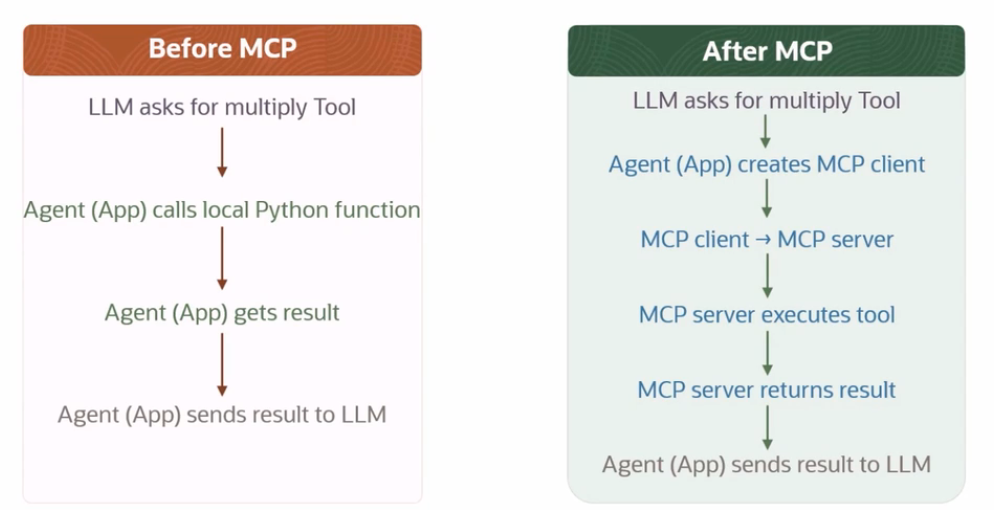

[🏠 Home](../README.md) › [Module 3: Introduction to MCP](README.md) › 3.4

# 3.4 Add an MCP Server to Your First Agent

## Adding an MCP Server to an AI Agent

## 1. Before MCP: The Monolithic Agent

- **Structure:** The agent code and tool logic (e.g., add, multiply, divide, `square_root`) lived together inside a single Python script using `@tool` decorators.

- **Limitations:**

  - Tools were trapped inside that specific program and could not be shared across other AI applications (e.g., Claude Desktop, ChatGPT, Cursor).

  - Code duplication was required to reuse tools in different projects.

  - Bug fixes required updating every individual script manually.

## 2. After MCP: Two-File Architecture

- **Structural Separation:** The application is split into two distinct files: the **Client** (the consumer/agent) and the **Server** (the tool provider).

- **The Agent File:** No longer contains any tool code; it holds only a configuration pointer connecting it to the external MCP server.

- **FastMCP Framework:** A specialized framework built on top of MCP used to build, test, and deploy servers, easily converting standard Python functions into tools accessible by AI models.

## 3. Implementing the MCP Server

- **Server Initialization:** Created using a simple declaration (e.g., FastMCP("math")). FastMCP automatically manages all underlying JSON-RPC protocol mechanics.

- **Tool Registration (`@mcp.tool`):**

  - Replaces LangChain's `@tool` decorator.

  - Reads Python type hints to generate the structured input schema.

  - Uses the function's docstring as the official tool description for client discovery (`tools/list`).

- **Execution:** Runs via standard input/output (stdin/stdout), waiting passively for incoming JSON-RPC messages rather than running independently.

## 4. Implementing the MCP Client

- **Path Definition:** Uses \_\_file\_\_ to get the absolute file path of the locally running script.

- **Connection Configuration:** Configured using three primary parameters:

  - **Name:** A human-readable label (e.g., "math") to distinguish servers in logs.

  - **Command:** The execution directive (e.g., "python") telling the client how to launch the server as a local child/sub-process.

  - **Transport:** Set to stdio (stdin/stdout), allowing direct communication without network overhead, HTTP, or open ports.

- **Multi-Server Capabilities:** Developers can list multiple servers (e.g., GitHub, Slack, Math) in one configuration dictionary. Internally, the client creates dedicated 1-to-1 connections for each server and merges all discovered tools into a single, unified list.

## 5. Architectural & Responsibility Shifts

- **The Execution Layer:** MCP inserts a standardized tool execution layer between the application and tools without replacing the LLM or the ReAct reasoning loop.

- **New Execution Flow:**

  1. LLM requests a tool call.

  2. Agent creates an MCP client.

  3. Client sends a JSON-RPC request to the MCP server.

  4. Server executes the tool locally and returns the result to the client.

  5. Client passes the result to the agent, which feeds it back into the LLM.

- **Application Role Shift:** Your application transitions from owning custom tool integrations and execution logic to acting purely as an **orchestrator**.

- **LLM Role:** Completely unchanged. The LLM still evaluates tool schemas, selects tools, generates arguments, and processes returned results identical to a non-MCP setup.

## 6. Why Use MCP? (Benefits & Use Cases)

- **Build Once, Use Everywhere:** A single server exposes tools automatically to any compatible AI client via dynamic discovery.

- **Centralized Maintenance:** Updating a tool or fixing a bug on the server instantly propagates to all connected AI agents.

- **Clean Codebases:** Isolating tool logic from agent reasoning makes applications much easier to test and maintain.

- **When to Use:** While MCP is overkill for trivial local math scripts, it is essential when integrating external systems, cloud resources, remote file operations, databases, or enterprise developer tools (Jira, GitHub, Slack).

---

### 🔗 Related

- **Model Context Protocol (MCP)** → [3.2 What Is MCP?](02-what-is-mcp.md)
- **MCP Host / Client / Server** → [3.3 Core MCP Concepts](03-core-mcp-concepts.md)
- 📖 [Glossary](../glossary.md)

---

⬅️ [3.3 Core MCP Concepts](03-core-mcp-concepts.md) | [⬆️ Module 3](README.md) | [3.5 Demo: MCP Server with LangChain Clients and Codex](05-demo-mcp-server-with-langchain-clients-and-codex.md) ➡️
