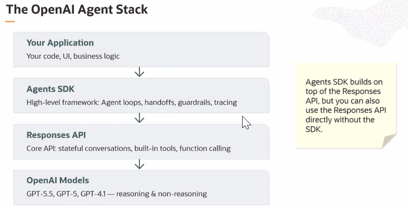

[🏠 Home](../README.md) › [Module 4: OpenAI Responses API & Agents SDK Basics](README.md) › 4.1

# 4.1 OpenAI Agent Stack

## Recap: What is an AI Agent?

- **Mental Model:** An LLM-based AI agent is a combination of three core elements:

  - **LLM (The Brain):** Understands and reasons.

  - **Tools (The Hands):** Allows the agent to act in the real world.

  - **Loop (The Nervous System):** Keeps the process going iteratively.

- **Core Properties of Agents:**

  - **Goal-directed:** They work towards a specific objective.

  - **Autonomous:** They choose their next steps dynamically.

  - **Tool-using:** They execute actions, not just generate text.

  - **Iterative:** They continuously refine their approach.

## The OpenAI Agent Stack

The stack is structured in four layers, built from the bottom up:

## 1. OpenAI Models (Bottom Layer)

- The foundation that powers the stack.

- **Reasoning Models:** (e.g., GPT 5) Think step-by-step for complex tasks.

- **Fast Non-Reasoning Models:** (e.g., GPT 4.1) Optimized for quick responses.

- *(Note: The latest model mentioned in this recording is GPT 5.5).*

## 2. Responses API (Second Layer)

- OpenAI's flagship API for building agents.

- **Stateful:** Remembers conversation history automatically.

- **Capabilities:** Supports function calling and built-in tools (web search, file search, code interpreter).

## 3. Agents SDK (Third Layer)

- A higher-level Python framework built *on top* of the Responses API.

- **Capabilities:** Simplifies defining agents, orchestrating multi-agent workflows, adding guardrails, and tracing/debugging systems.

## 4. Application (Top Layer)

- Your custom business logic, UI, and specific application code.

## Decision Tree: Responses API vs. Agents SDK

Neither approach is inherently better; they are designed for different levels of complexity.

## Q1: Do you need multi-step logic?

- **No:** (You just want to ask a question, call a tool once, and get an answer).

  - **Action:** Use the **Responses API**. It is simpler, more direct, and gives you full control.

- **Yes:** Move to the next question.

## Q2: Do you need multiple agents, guardrails, or orchestration?

- **No:**

- **Action:** You can technically still use the **Responses API**. However, this is advanced usage because you will have to write and manage the "loop" (the nervous system) entirely yourself.

- **Yes:**

  - **Action:** Use the **Agents SDK**. It provides structure, automation, and built-in capabilities.

## The Car Analogy:

- **Responses API:** Like building a car engine from scratch. You have full control but must build everything.

- **Agents SDK:** Like using a car that already has an engine, steering, and safety systems built-in. You still decide where the car goes, but the underlying systems are handled for you.

## Real-World Example: Flight Booking

- **Scenario:** A user asks, *"Find me the cheapest flight from Austin to Zurich and book it."*

- **If using Responses API:** You (the developer) must manually orchestrate calling the search tool, processing the results, calling the booking tool, managing retries, and handling failures.

- **If using Agents SDK:** The multi-step logic, loop, and guardrails are handled automatically. The agent plans its steps, calls the tools, loops on its own, and returns the final booked result, making development much simpler.

## Core Takeaway

- **Responses API:** You are responsible for building the loop, orchestration layer, and nervous system manually.

- **Agents SDK:** The loop and orchestration are built for you.

---

### 🔗 Related

- **Orchestration Layer** → [1.2 Agentic AI Core Components](../01-introduction-to-ai-agents/02-agentic-ai-core-components.md)
- **Guardrails** → [1.5 Safety & Guardrails](../01-introduction-to-ai-agents/05-safety-and-guardrails.md)
- **Responses API** → [4.2 OpenAI Responses API](02-openai-responses-api.md)
- **Agents SDK** → [4.3 OpenAI Agents SDK](03-openai-agents-sdk.md)
- 📖 [Glossary](../glossary.md)

---

⬅️ [3.7 Summary](../03-model-context-protocol/07-summary.md) | [⬆️ Module 4](README.md) | [4.2 OpenAI Responses API](02-openai-responses-api.md) ➡️
