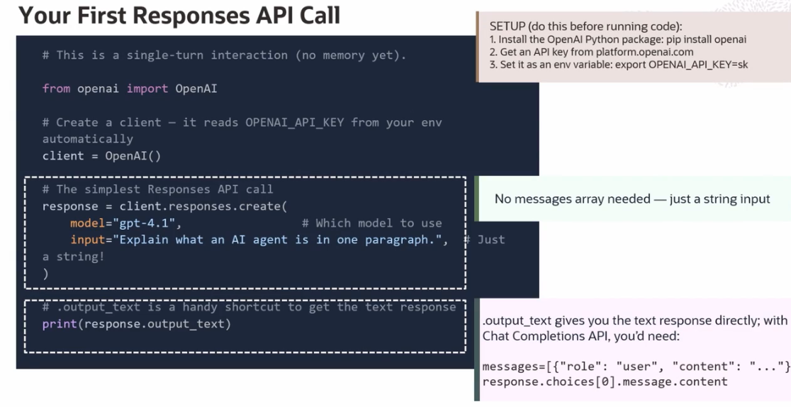
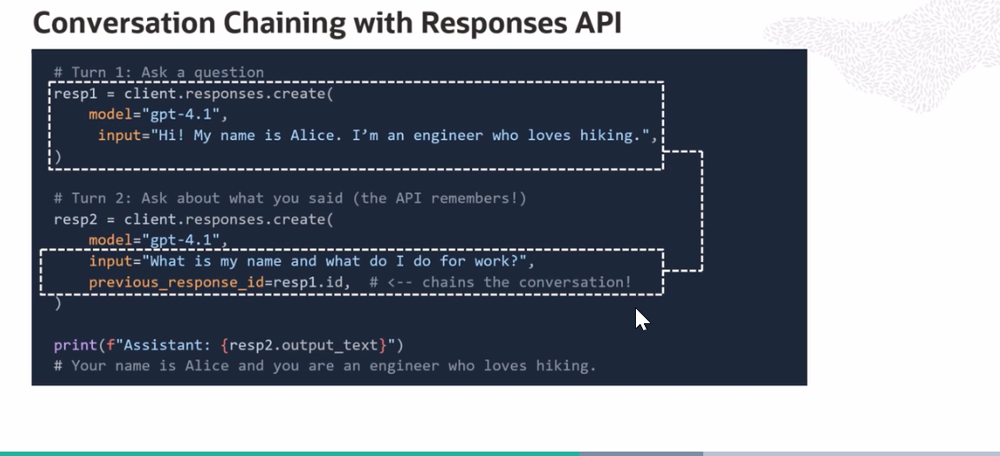
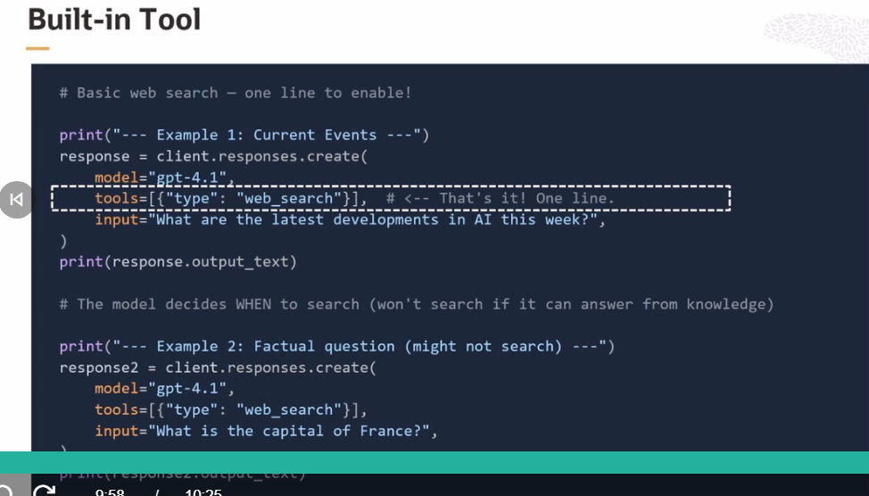

[🏠 Home](../README.md) › [Module 4: OpenAI Responses API & Agents SDK Basics](README.md) › 4.2

# 4.2 OpenAI Responses API

## OpenAI Responses API: Detailed Study Notes

## 1. Overview and Background

- **Definition:** The core interface for interacting with OpenAI models, allowing users to send inputs, receive structured outputs, enable tool usage, and chain conversations.

- **Release Date:** March 2025.

- **Strategic Direction:** It is OpenAI's newest and most powerful API, designed to completely replace and improve upon the older **Chat Completions API** and the **Assistants API**.

## 2. Core Features

The Responses API introduces several major improvements:

- **Simpler Input:** Pass plain strings or structured inputs and receive direct output text.

- **Conversation Chaining:** Control conversation flow and link turns without resending history.

- **Tool Integration:** Enable powerful tools (like web search) with a single line of code.

- **Model-Driven Tool Usage:** The model autonomously decides when to execute tools versus when to rely on its internal knowledge.

- **Efficient Execution:** Optimized for improved performance and caching.

## 3. Setup and Initialization

Before making an API call, three setup steps are required:

1. **Install the Package:** Run pip install openai in your environment.

2. **Acquire API Key:** Obtain a key from the OpenAI platform (`openai.com`).

3. **Set Environment Variables:**

    - Mac: export `OpenAI_key`

    - Windows: set `OpenAI_API_key`

- *Note:* When initializing the client in code (client = `OpenAI()`), it will automatically read the API key from the environment.

## 4. Deep Dive: Top 3 Capabilities

## Feature 1: Simpler Input and Output

- **The Old Way (Chat Completions API):** Required a highly structured conversation history (the "message array"). Extracting the answer required complex parsing, such as navigating through `response.choices`\[0\].`message.content`.

- **The New Way (Responses API):**

  - **Input:** You call `client.responses.create` and simply pass the model (e.g., gpt-4.1) and a plain text string as the input. No message array is needed.

  - **Output:** The response object includes a direct `output_text` property, granting immediate access to the generated text.

## Feature 2: Conversation Chaining (State Management)

- **The Problem:** In older APIs, developers had to manually track and resend the entire conversation history with every new request. As conversations grew, this consumed excessive tokens and increased costs.

- **The Solution:** The Responses API features built-in, server-side state management.

- **How it Works:**

  - You pass a `previous_response_id` parameter linking to the ID of the last response.

  - The API walks backward through this chain to recover context automatically.

- **Benefits:**

  - The model remembers prior context (e.g., user names, previous inputs).

  - Eliminates the need to shuttle large tool payloads back and forth.

  - Significantly reduces bandwidth and token consumption.

## Feature 3: Built-in, Model-Callable Tools

You can enable powerful tools by simply adding them to a tools array in your API call (literally one line of code). No extra integration code is required.

- **Available Built-in Tools:**

  - **Web Search:** Searches the internet for current, real-time information.

  - **File Search:** Searches through user-uploaded documents (ideal for corporate documents or RAG systems).

  - **Code Interpreter:** Writes and executes Python code; excellent for data analysis within a container or VM.

  - **Computer Use (Beta/Experimental):** Allows the model to control a computer interface, click buttons, and fill out forms.

  - **Image Generation:** Uses DALL-E to create images.

- **Autonomous Decision Making:** The model is smart enough to know *when* a tool is needed. For example:

  - Prompt: *"What are the latest AI developments this week?"* -\> Triggers Web Search.

  - Prompt: *"What is the capital of France?"* -\> Bypasses Web Search and answers "Paris" directly from internal knowledge.

---

### 🔗 Related

- **Chains / LCEL** → [2.3 Demo: LangChain Building Blocks](../02-langchain-for-ai-agents/03-demo-langchain-building-blocks.md)
- 📖 [Glossary](../glossary.md)

---

⬅️ [4.1 OpenAI Agent Stack](01-openai-agent-stack.md) | [⬆️ Module 4](README.md) | [4.3 OpenAI Agents SDK](03-openai-agents-sdk.md) ➡️
