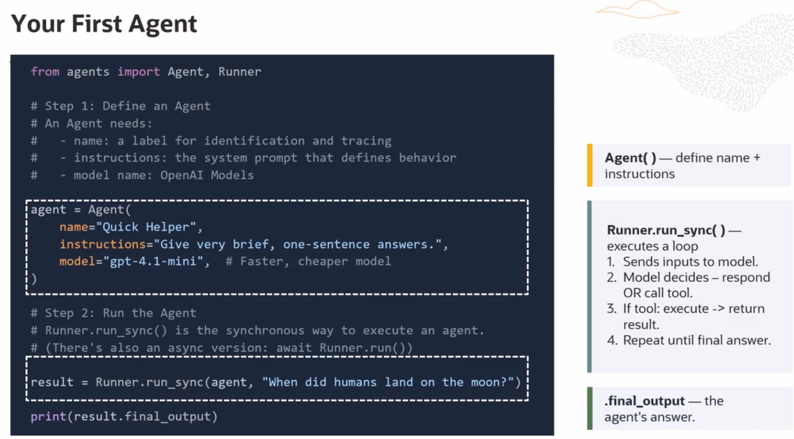

[🏠 Home](../README.md) › [Module 4: OpenAI Responses API & Agents SDK Basics](README.md) › 4.3

# 4.3 OpenAI Agents SDK

## Overview & Setup

- **Definition:** The OpenAI Agents SDK is a Python framework built on top of the Responses API. It helps developers define agents, manage tool usage, and build multi-agent systems.

- **Installation:** Run pip install openai agents to set up the environment.

## 6 Key Concepts of the Agents SDK

## 1. Agent

- The foundational unit consisting of a combination of an LLM, instructions, tools, and a loop.

## 2. Runner

- The engine that executes the agent. It actively manages the agent loop, meaning it calls the LLM, executes tools, and loops until the task is complete.

## 3. Tools

- Standard Python functions converted into actions that your agent can call.

## 4. Handoffs

- A mechanism to transfer control from one agent to another. This is highly effective for building specialized agent teams.

## 5. Guardrails

- Input and output validators designed to keep agents safe and explicitly on topic.

## 6. Tracing

- Built-in debugging capabilities that allow you to track every step the agent took and monitor every tool it executed.

## 3-Step Process to Implement Your First Agent

## Step 1: Define the Agent

- **Action:** Import the Agent (the blueprint) and the Runner (the engine).

- **Configuration:** Create the agent by assigning it a **Name** (acts as a job title) and **Instructions** (acts as a job description), along with specifying the model.

## Step 2: Run the Agent

- **Action:** Execute the agent to initiate the loop. This step hands control over to the Agents SDK.

- **Execution Methods:**

  - **Synchronous:** `runner.run_sync`

  - **Asynchronous:** await `runner.run`

## Step 3: Get the Output

- **Action:** Extract the final text response from the agent.

- **Code Execution:** Access the response directly using the `result.final_output` property.

## Under the Hood: The Runner & The Loop

- **The "Secret Sauce":** The Runner is the core mechanism orchestrating the agentic loop. It decides when to call the LLM, when to execute tools, when to continue, and when to terminate.

- **Execution Flow:**

  1. The Runner calls the underlying Responses API.

  2. The LLM evaluates the input and decides whether it needs to call a registered tool.

  3. **If No Tool is Needed:** The LLM generates the final text response and returns it to your code.

  4. **If a Tool is Needed:** The model requests a tool call, the Runner executes it, returns the results to the LLM, and loops back multiple times if necessary before producing the final answer.

---

### 🔗 Related

- **Agent Loop** → [1.1 What Is an AI Agent?](../01-introduction-to-ai-agents/01-what-is-an-ai-agent.md)
- **Responses API** → [4.2 OpenAI Responses API](02-openai-responses-api.md)
- 📖 [Glossary](../glossary.md)

---

⬅️ [4.2 OpenAI Responses API](02-openai-responses-api.md) | [⬆️ Module 4](README.md) | [4.4 Demo: Responses API and Agents SDK](04-demo-responses-api-and-agents-sdk.md) ➡️
