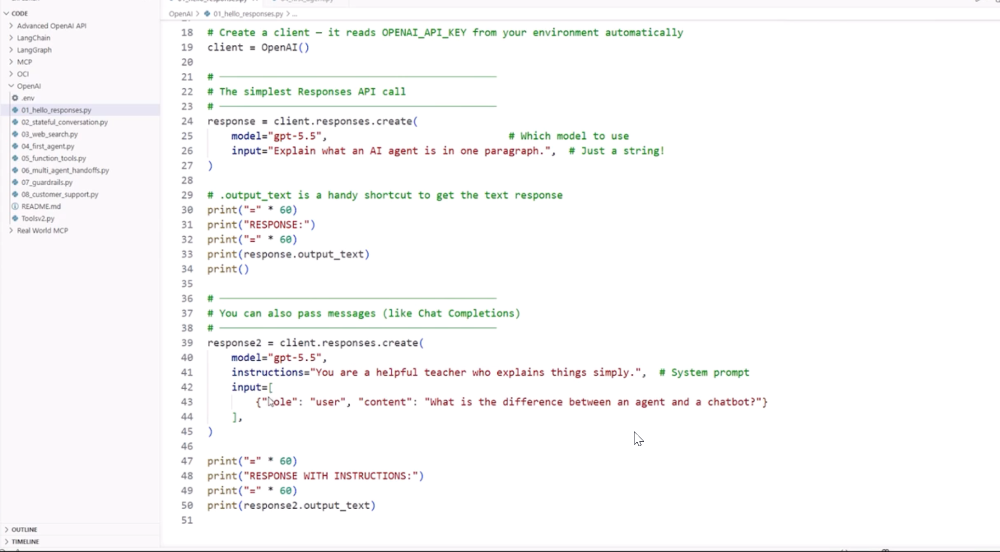
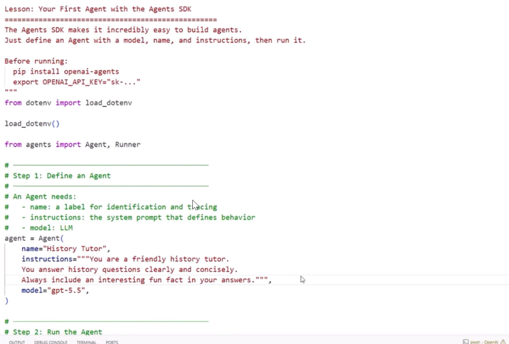

[🏠 Home](../README.md) › [Module 4: OpenAI Responses API & Agents SDK Basics](README.md) › 4.4

# 4.4 Demo: Responses API and Agents SDK

## Part 1: OpenAI Responses API Demo

- **Prerequisite Installation:** Run pip install openai in your terminal.

- **Client Initialization:** The script creates a client that automatically reads the OpenAI API key from the environment.

- **The Simplest API Call:**

  - Initiated by creating a response object (e.g., `client.responses`).

  - Requires passing the target model (e.g., gpt-5.5).

  - Accepts the prompt as a simple, plain string (e.g., *"what is an AI agent"*).

- **Extracting Output:** The resulting text is accessed directly and simply via the `response.output_text` property.

- **Advanced Message Formatting:** Similar to the older Chat Completions API, you can still pass structured message arrays containing system instructions, input roles (like "user"), and specific content.

## Part 2: OpenAI Agents SDK Demo

- **Prerequisite Installation:** Run pip install openai agents in your terminal. Like the Responses API, it requires an active OpenAI API key to execute.

- **Agent Creation:** Initialized by explicitly providing the model, a designated name, and specific instructions.

- **Execution Mechanisms (The Runner):** The Runner orchestrates the underlying agentic loop. It supports two execution methods:

  - **Synchronous Execution:** Uses Runner.`run_sync`.

  - **Asynchronous Execution:** Uses await Runner.run.

- **Example Queries Executed:** *"who was the first president of the United States"* and *"what caused World War 1"*.

---

### 🔗 Related

- **Responses API** → [4.2 OpenAI Responses API](02-openai-responses-api.md)
- **Agents SDK** → [4.3 OpenAI Agents SDK](03-openai-agents-sdk.md)
- 📖 [Glossary](../glossary.md)

---

⬅️ [4.3 OpenAI Agents SDK](03-openai-agents-sdk.md) | [⬆️ Module 4](README.md) | [4.5 Tools & Function Calling](05-tools-and-function-calling.md) ➡️
