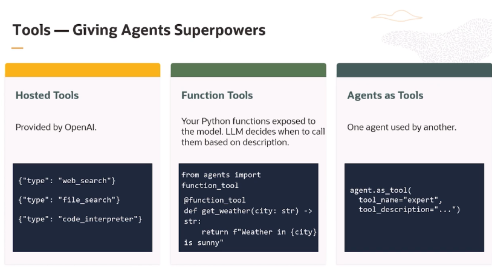
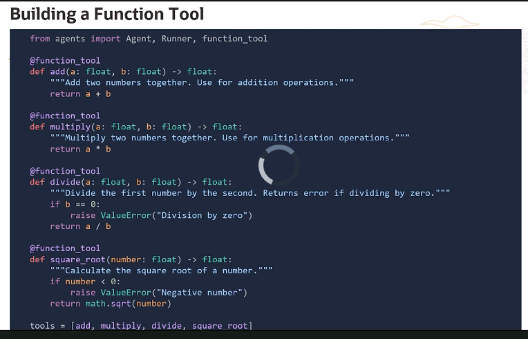
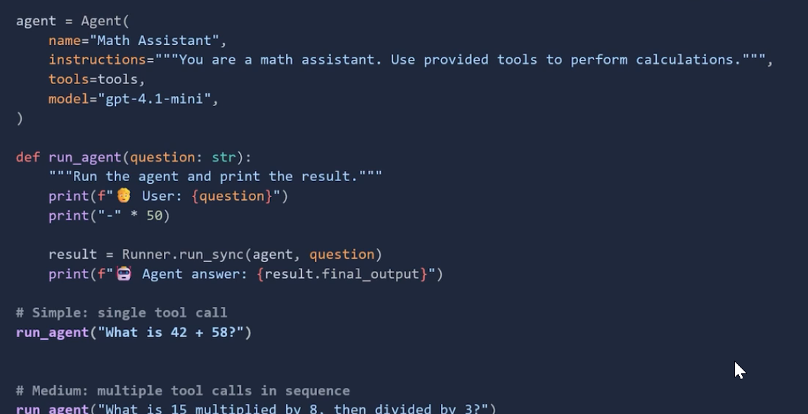
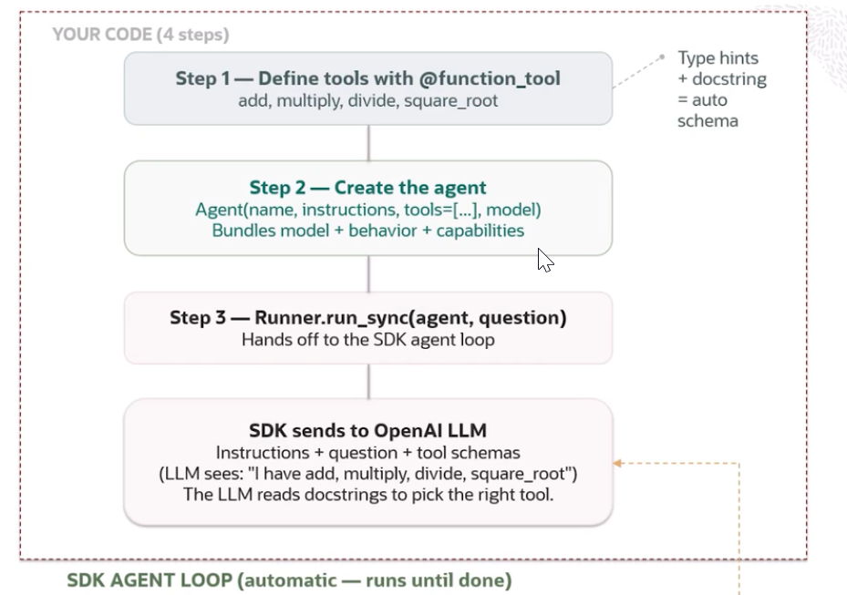
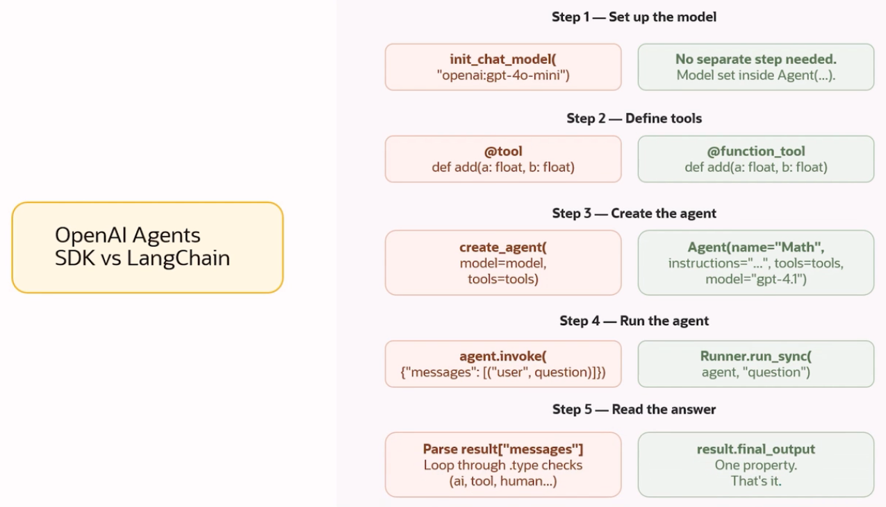

[🏠 Home](../README.md) › [Module 4: OpenAI Responses API & Agents SDK Basics](README.md) › 4.5

# 4.5 Tools & Function Calling

## Tools and Function Calling in the OpenAI Agents SDK

## The Core Value of Tools

- **Defining Trait:** Tools are what give AI agents their true power. Without tools, an agent is simply a chatbot.

## Three Types of Tools in the Agents SDK

1. **Hosted Tools**

    - **Provider:** Provided directly by OpenAI.

    - **Examples:** Web search (searches the internet), Code interpreter (runs Python code), and File search (searches uploaded documents).

    - **Implementation:** Ready to use immediately. Enabled by adding them to the agent's tool list with a single line of code.

2. **Function Tools**

    - **Definition:** Your own custom Python functions.

    - **Implementation:** Uses the `@function_tool` decorator.

    - **Schema Generation:** The SDK automatically generates the JSON function schema required by the model by reading the function's type hints and docstring.

3. **Agents as Tool**

    - **Definition:** One agent used by another (using `agent.as_tool`).

    - **Use Case:** Allows a manager agent to delegate tasks to specialized worker agents. *(Note: Out of scope for this specific course level).*

- **Rule of Thumb:** Always start with Built-in/Hosted Tools (e.g., for web or file searches). Only move to Custom Function Tools when you require custom logic.

## Implementation Workflow & The Agentic Loop

## Step 1: Define the Tools

- Import `function_tool` from the agents package.

- Write a regular Python function and decorate it with `@function_tool`.

- **Critical Requirements:** You must include **type hints** (e.g., specifying inputs as floating point) and a **docstring**. These elements are automatically parsed to build the tool description and JSON schema the LLM uses to communicate.

## Step 2: Create the Agent

- Bundle the model's behavior and capabilities into a single definition.

- Provide the model name, list of tools, system instructions, and the agent's name.

## Step 3: Run the Agent

- Call the agent using the `run_sync` method along with the user's question.

- At this point, the SDK hands the process off to the automated agent loop.

## Step 4: The Execution Loop

The SDK sends the user query to the OpenAI LLM.

The LLM evaluates the question and decides if a tool is needed.

1. **Iteration 1:** If a tool is needed, the LLM sends a request back to the agent. The agent executes the tool and returns the result to the LLM.

2. **Iteration 2+:** The loop repeats until the LLM decides no more tools are necessary, at which point it composes and returns a final natural language response.

## Framework Comparison: OpenAI Agents SDK vs. LangChain

- While both frameworks achieve similar outcomes, the OpenAI Agents SDK is generally considered cleaner and more lightweight for beginners. Here is a 5-step comparison of their developer experiences:

| **Step**                  | **LangChain**                                                                                                                                        | **OpenAI Agents SDK**                                                                                                            |
|---------------------------|------------------------------------------------------------------------------------------------------------------------------------------------------|----------------------------------------------------------------------------------------------------------------------------------|
| **1. Model Setup**        | Requires explicit, manual initialization (`init_chat_model`) before use.                                                                               | Configured directly inside the agent definition, reducing setup overhead.                                                        |
| **2. Defining Tools**     | Uses the `@tool` decorator.                                                                                                                            | Uses the `@function_tool` decorator. Streamlined and native with less boilerplate code.                                            |
| **3. Agent Creation**     | Built on top of a larger, complex orchestration framework (chains, prompts, memory). Separates model, tools, and orchestration into multiple layers. | Consolidates everything into a single, lightweight, and opinionated agent definition.                                            |
| **4. Execution**          | Requires invoking the agent through a message-based interface.                                                                                       | Provides a cleaner execution flow via a direct runner abstraction (e.g., `run_sync`).                                              |
| **5. Getting the Answer** | Often requires manually parsing structured outputs and handling different message types.                                                             | Simplified by the underlying Responses API. The text output is exposed directly through a single property (`result.final_output`). |

---

### 🔗 Related

- **Agent Loop** → [1.1 What Is an AI Agent?](../01-introduction-to-ai-agents/01-what-is-an-ai-agent.md)
- **Orchestration Layer** → [1.2 Agentic AI Core Components](../01-introduction-to-ai-agents/02-agentic-ai-core-components.md)
- **LangChain** → [2.2 Introduction to LangChain](../02-langchain-for-ai-agents/02-introduction-to-langchain.md)
- **Agents SDK** → [4.3 OpenAI Agents SDK](03-openai-agents-sdk.md)
- 📖 [Glossary](../glossary.md)

---

⬅️ [4.4 Demo: Responses API and Agents SDK](04-demo-responses-api-and-agents-sdk.md) | [⬆️ Module 4](README.md) | [4.6 Multi-Agent Handoff](06-multi-agent-handoff.md) ➡️
