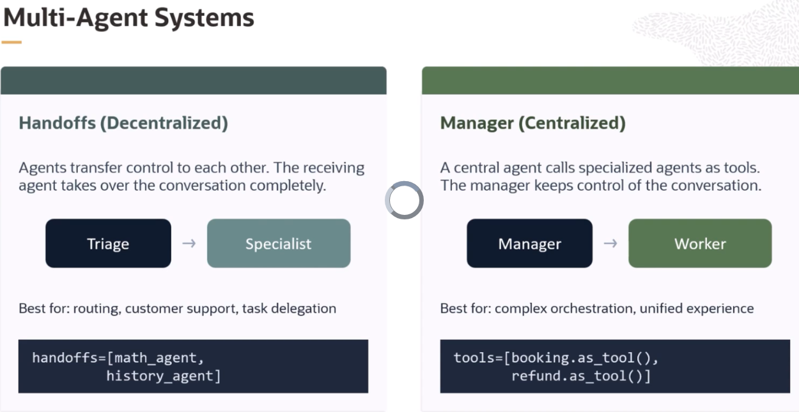
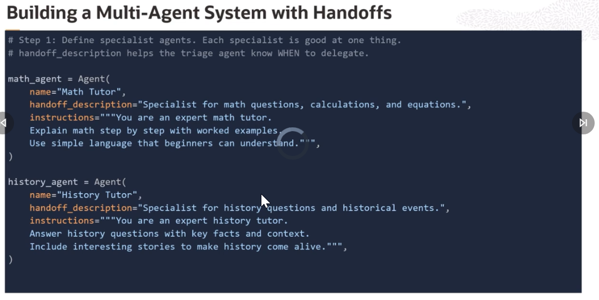
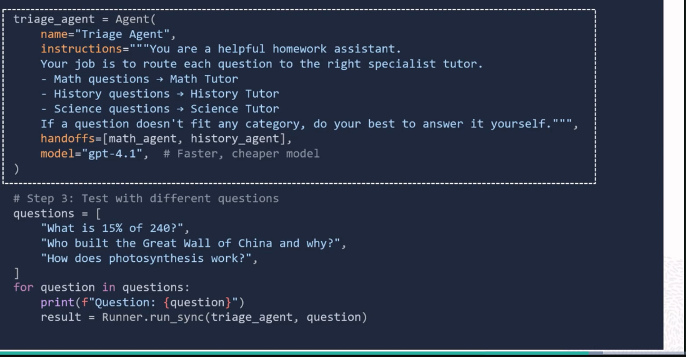

[🏠 Home](../README.md) › [Module 4: OpenAI Responses API & Agents SDK Basics](README.md) › 4.6

# 4.6 Multi-Agent Handoff

## Multi-Agent Systems in the OpenAI Agents Stack

**Core Concept:** Multi-agent systems are utilized when a task is too complex for a single AI agent to handle effectively. The OpenAI stack primarily uses two architectural patterns to manage this: Handoffs and Manager.

## 1. The Handoffs Pattern (Decentralized Model)

- **How it Works:** A "triage" agent receives the initial user question, determines which specialist agent is best equipped to handle it, and completely transfers (hands off) control of the conversation to that specialist.

- **Context:** The specialist agent takes over completely and is able to see the full conversation history.

- **Example Use Case:** A customer support routing system where initial queries are seamlessly handed off to dedicated billing, shipping, or technical support agents.

## 2. The Manager Pattern (Centralized Model)

- **How it Works:** A central manager agent remains in continuous control of the interaction. It delegates tasks by calling specialized agents using the "agent as tools" mechanism.

- **User Interaction:** The user only ever communicates with the central manager. The manager synthesizes the outputs from the various specialists into a single, unified response.

- **Example Use Case:** A project manager agent that delegates specific sub-tasks to a researcher agent, a writer agent, and a reviewer agent, while maintaining control over the final deliverable.

**Mental Model / Rule of Thumb:** Start with the **Handoffs pattern** for simpler routing scenarios. Graduate to the **Manager pattern** only when you specifically need one agent to actively coordinate multiple specialists.

## Code Walkthrough: Building a Handoffs System

## Step 1: Define the Specialist Agents

- **Action:** Create the individual agents (e.g., a "Math Tutor" agent and a "History" agent).

- **Configuration:** Provide each specialist with a name and system instructions to strictly control their behavior.

- **The Handoff Description:** You must provide a specific handoff description for each specialist. This is the crucial trigger that tells the triage agent *when* it should delegate to that particular specialist.

## Step 2: Define the Triage Agent

- **Action:** Create the primary routing agent (e.g., Name: "Triage").

- **Configuration:** Give it system instructions defining its exact job: routing questions to the correct specialist. Specify the model it should use.

## Step 3: Specify the Handoffs Parameter

- **Action:** List all the specialist agents that the triage agent is permitted to hand off to (e.g., the Math agent and the History agent). While this example uses two, production workloads may have many more.

- **Under the Hood:** The framework automatically converts each handoff option into a tool (e.g., it creates a "transfer to Math agent" tool and a "transfer to History agent" tool).

## Step 4: Run the Triage Agent

- **Action:** Execute the triage agent and pass in the user's prompt.

- **Execution Flow Examples:**

  - If the user asks *"what is 15% of 240?"*, the triage agent recognizes the math context, triggers the handoff to the Math agent, and the Math agent returns 180.

  - If the user asks about the *"Great Wall of China"*, the triage agent recognizes the historical context and routes the conversation entirely to the History agent.

---

⬅️ [4.5 Tools & Function Calling](05-tools-and-function-calling.md) | [⬆️ Module 4](README.md) | [4.7 Guardrails and Safety](07-guardrails-and-safety.md) ➡️
