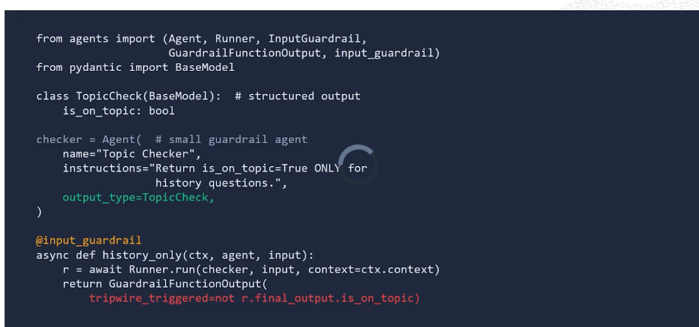

[🏠 Home](../README.md) › [Module 4: OpenAI Responses API & Agents SDK Basics](README.md) › 4.7

# 4.7 Guardrails and Safety

## AI Agent Guardrails

Guardrails act as safety nets that control an LLM agent's inputs and outputs. They can run in parallel for speed or block the agent entirely for safety.

- **Functionality:** A guardrail is a small helper agent or function. If it fails a check, it triggers a **tripwire** (an exception) that stops the main agent before damage occurs.

## Types of Guardrails (OpenAI Agents SDK)

- **Input Guardrails:** Run *before* the agent processes input.

  - *Use Cases:* Blocking off-topic requests, detecting prompt injections, validating input formats.

- **Output Guardrails:** Run *after* the agent generates output.

  - *Use Cases:* Catching hallucinations, enforcing brand guidelines and tone, preventing sensitive data leaks.

  - 

## Implementation Steps

1. **Define a Pydantic Model:** Create a Python class to validate data structures (e.g., class TopicCheck returning a boolean).

2. **Create a Checker Agent:** Instruct it to evaluate the input (e.g., verify if a question is strictly about history) and return structured output using the Pydantic model.

3. **Define the Guardrail Function:** Use the `@input_guardrail` decorator. If the check fails (e.g., `is_on_topic` = False), set the tripwire to True to stop the main agent.

4. **Register the Guardrail:** Attach it to the main agent so it intercepts requests before processing.

## Agent Tracing

Tracing logs every action an agent takes. It is built-in and on by default in the OpenAI Agents SDK, though documentation should be checked for exact enablement steps.

- **Access:** Viewable via the OpenAI Dashboard (`platform.openai.com` -\> Dashboards -\> Traces). Traces can also be exported to external tools.

- **Logged Data:** Execution order of agents, tool calls (with arguments and results), handoff occurrences and reasons, guardrail pass/fail triggers, and token consumption per step.

- **Primary Uses:**

  - *Debugging:* Investigating why an agent provided an incorrect answer.

  - *Optimization:* Identifying high token usage steps to save costs.

  - *Evaluation:* Verifying if the correct tools and handoffs were utilized.

---

### 🔗 Related

- **Guardrails** → [1.5 Safety & Guardrails](../01-introduction-to-ai-agents/05-safety-and-guardrails.md)
- **Agents SDK** → [4.3 OpenAI Agents SDK](03-openai-agents-sdk.md)
- **Handoff** → [4.6 Multi-Agent Handoff](06-multi-agent-handoff.md)
- 📖 [Glossary](../glossary.md)

---

⬅️ [4.6 Multi-Agent Handoff](06-multi-agent-handoff.md) | [⬆️ Module 4](README.md) | [4.8 Putting It All Together](08-putting-it-all-together.md) ➡️
