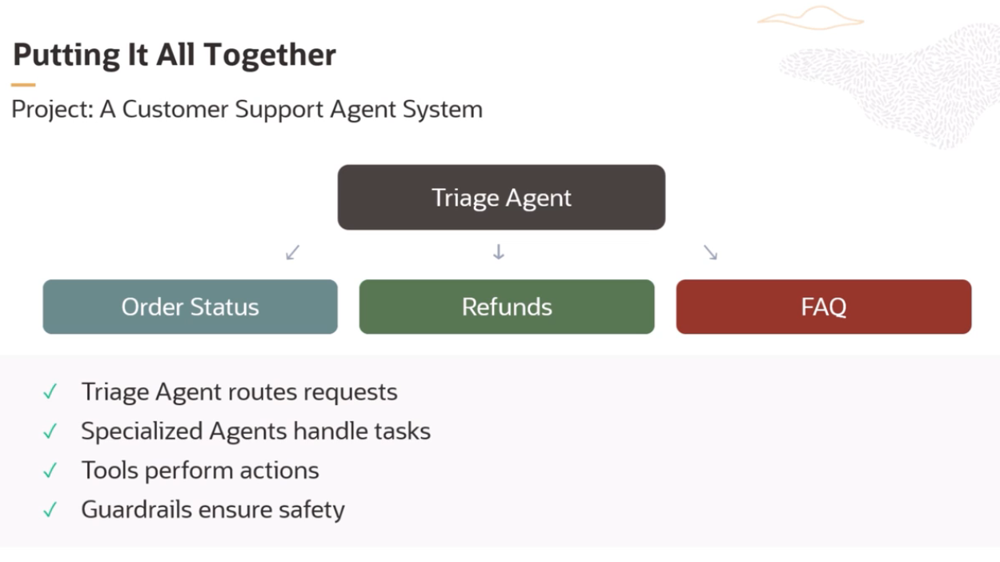
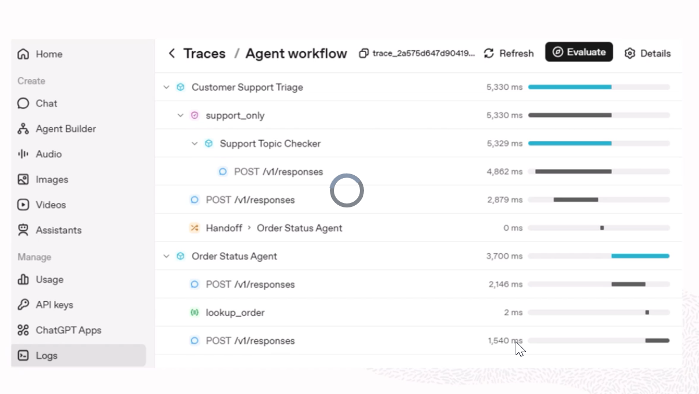

[🏠 Home](../README.md) › [Module 4: OpenAI Responses API & Agents SDK Basics](README.md) › 4.8

# 4.8 Putting It All Together

## Multi-Agent Customer Support System

## 1. Module Concepts Integrated

This project combines all previous lesson concepts into a single real-world application:

- OpenAI Agents Stack

- OpenAI Responses API

- Agents SDK

- Tools & Function Calling

- Multi-Agent Systems with Handoffs

- Guardrails & Safety

## 2. System Architecture

The system uses a routing architecture where a primary agent directs traffic to specialized agents.

- **Triage Agent:** Receives all initial customer messages and routes them to the correct specialist via SDK handoffs.

- **Order Status Agent:** Uses a custom Python function tool to look up specific order details locally.

- **Refund Agent:** Uses a custom function tool to process refund requests.

- **FAQ Agent:** Answers general questions using the OpenAI built-in, hosted web search tool.

## 3. Execution Flow (Case Study: "Where is my order ORD-001?")

The process is broken down into two distinct phases using OpenAI Tracing.

## Phase 1: Customer Support Triage (~5 seconds)

1. **Input Guardrails (Support Topic Checker):** A small agent spins up to check if the prompt is a valid customer support question. This is a "cold start" LLM call (POST/v1/responses) and takes the longest (nearly 5 seconds).

2. **Triage Processing:** Once the guardrail passes, the Triage agent makes an LLM call to evaluate the prompt and determine the routing destination.

3. **Handoff:** The SDK instantly switches control to the Order Status agent. This requires zero LLM calls; it is strictly a local pointer change.

## Phase 2: Specialized Agent Execution (~4 seconds)

1. **Tool Selection (1st LLM Call, ~2s):** The Order Status agent evaluates the question against its Lookup Order tool schema and determines it needs to call the function.

2. **Tool Execution (2 milliseconds):** The local Python function executes (e.g., querying a local dictionary). *Note: In production with MCP or HTTPS calls, this would take slightly longer.*

3. **Response Generation (2nd LLM Call, ~1.5s):** The raw data from the tool is fed back to the LLM, which composes a natural language response for the customer.

## 4. Performance & Optimization (Tracing Insights)

- **Time Distribution:** In a standard 11.4-second interaction, the vast majority of time is spent waiting on LLM API calls (4 calls in this example).

- **Code Efficiency:** Local code execution (guardrail logic, handoffs, custom tools) takes only a few milliseconds combined.

- **Core Takeaway:** To speed up agentic systems in production, developers must optimize the *number* and *size* of LLM calls, rather than optimizing the local tool functions.

How will you handle caching or state management to reduce the latency of those initial "cold start" guardrail LLM calls in a live environment?

---

### 🔗 Related

- **Guardrails** → [1.5 Safety & Guardrails](../01-introduction-to-ai-agents/05-safety-and-guardrails.md)
- **Handoff** → [4.6 Multi-Agent Handoff](06-multi-agent-handoff.md)
- **Tracing** → [4.3 OpenAI Agents SDK](03-openai-agents-sdk.md)
- 📖 [Glossary](../glossary.md)

---

⬅️ [4.7 Guardrails and Safety](07-guardrails-and-safety.md) | [⬆️ Module 4](README.md) | [4.9 Demo: Customer Support Agent](09-demo-customer-support-agent.md) ➡️
