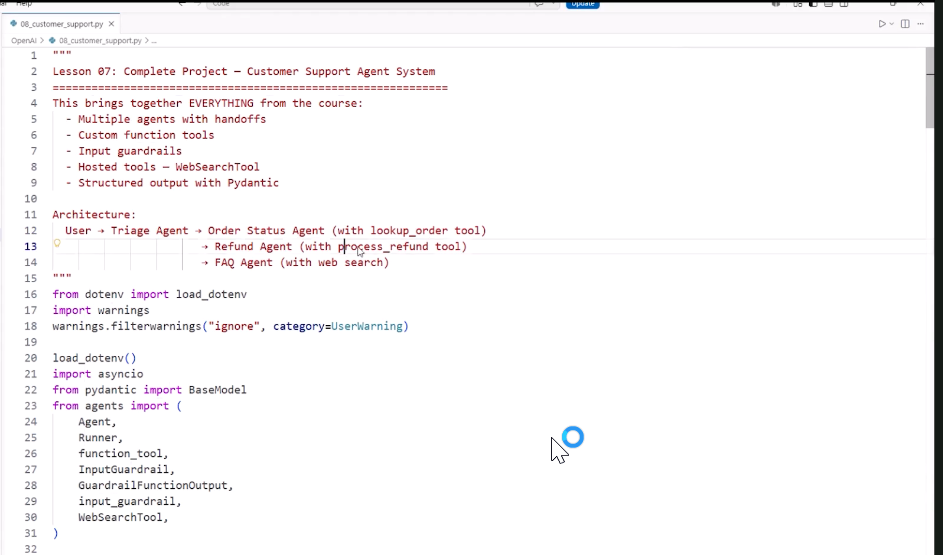
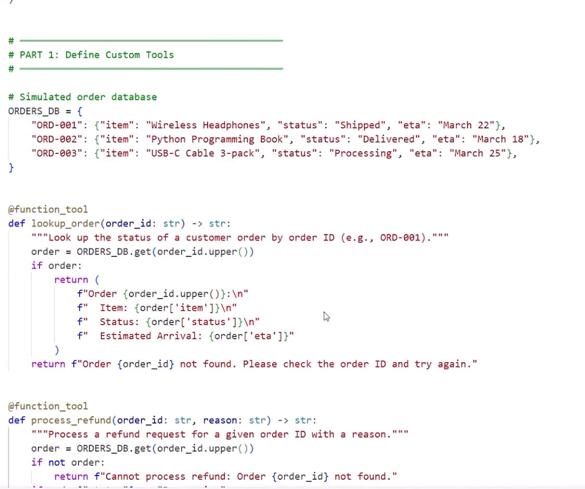
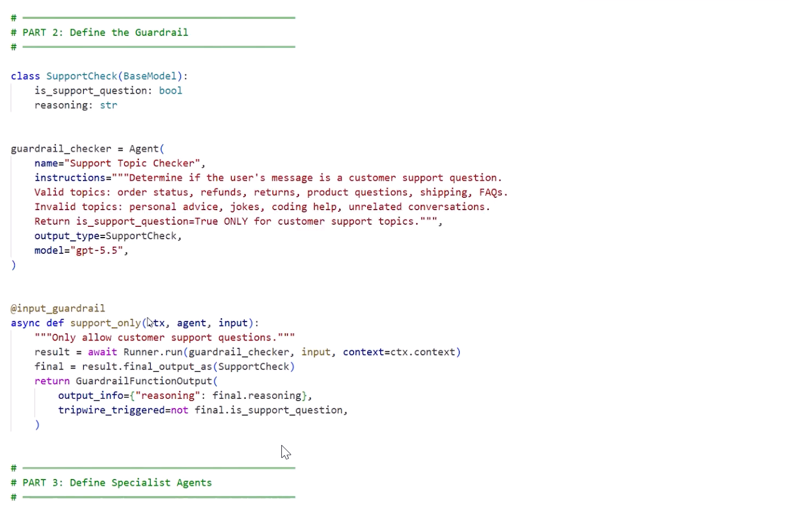
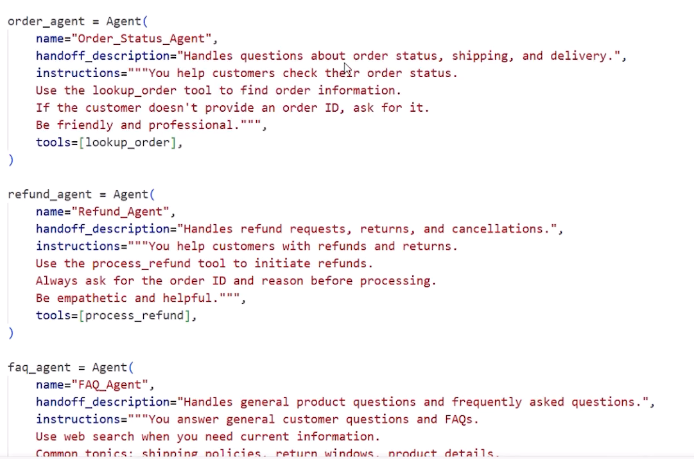
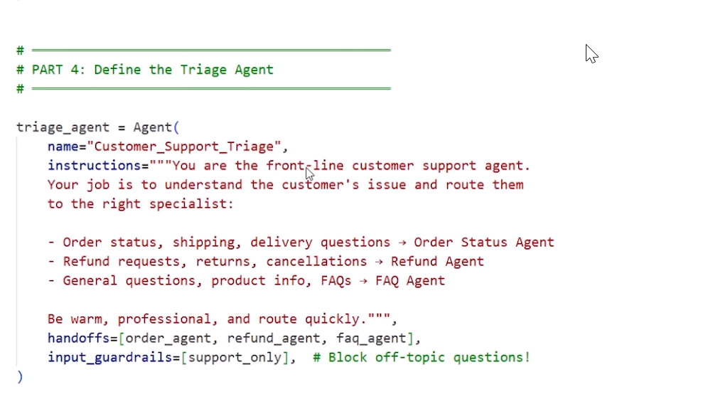
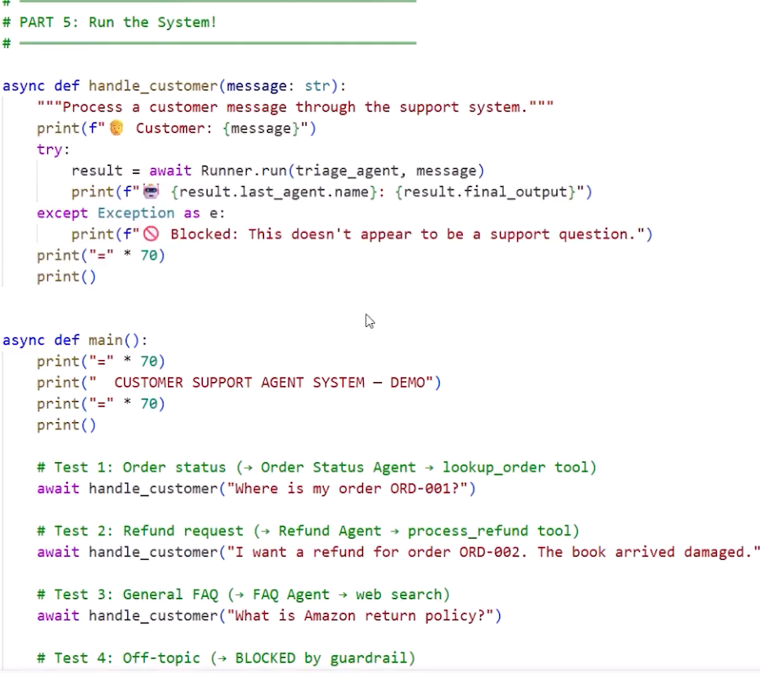

[🏠 Home](../README.md) › [Module 4: OpenAI Responses API & Agents SDK Basics](README.md) › 4.9

# 4.9 Demo: Customer Support Agent

## 1. Core Concepts Implemented

This demo integrates five major framework capabilities into a single cohesive project:

- **Multiple Agents with Handoffs:** Routing tasks between agents (from Lesson 5).

- **Custom Function Tools:** Executing local Python code (from Lesson 4).

- **Hosted Tools:** Utilizing built-in models like web search (from Lesson 2).

- **Input Guardrails:** Blocking off-topic prompts (from Lesson 6).

- **Structured Output (Pydantic):** Defining and validating data structures for guardrails.

## 2. System Architecture

The application uses a hub-and-spoke routing model consisting of one primary agent and three specialists.

- **Triage Agent (Hub):** The frontline agent. Receives the initial user prompt, evaluates the required routing, and hands off the full conversation history to the appropriate specialist. It also houses the input guardrail.

- **Order Status Agent (Spoke 1):** Uses a custom Python function (`lookup_order`) to retrieve simulated order shipping dates and details.

- **Refund Agent (Spoke 2):** Uses a custom Python function (`process_refund`) to handle return logistics.

- **FAQ Agent (Spoke 3):** Uses a hosted web search tool to find answers to general questions (e.g., store policies).

## 3. Implementation Phases

1. **Define Custom Tools & Data:**

    - Set up a mock local database (a Python dictionary with orders 1, 2, and 3).

    - Write the local Python functions (`lookup_order`, `process_refund`) that the specialist agents will call.

2. **Configure Input Guardrails:**

    - Create a Pydantic model to mandate the required data structure.

    - Deploy a lightweight "Checker Agent" (powered by GPT-5.5) instructed to return true only for support-related topics.

    - Define the guardrail function: If the checker agent evaluates the input as false, it triggers a tripwire (`tripwire_triggered` = true) and hard-stops the process to prevent off-topic interactions.

    - Register this guardrail directly onto the main Triage Agent.

3. **Deploy Agents & Handoffs:**

    - Define instructions for the three specialist agents.

    - Configure the Triage agent with its routing logic and register the specialist agents as allowable handoff targets.

## 4. Demo Test Scenarios

- **Valid Request (Order):** User asks "Where is my order?" -\> Triage Agent routes to Order Status Agent -\> Custom tool queries the local mock database -\> Returns shipping date.

- **Valid Request (FAQ):** User asks "What is Amazon's return policy?" -\> Triage Agent routes to FAQ Agent -\> Web Search tool scrapes the web -\> Returns real policy details.

- **Invalid Request (Off-Topic):** User asks "Write a poem about cats" -\> Triage Agent's Input Guardrail activates -\> Checker Agent flags it as non-support -\> System blocks the request entirely.

## 5. Transitioning to Production

To scale this demo for real-world enterprise use, the following upgrades are required:

- Connect custom tools to live, external databases using Model Context Protocol (MCP) rather than local mock dictionaries.

- Scale the number of specialist agents for more granular task handling.

- Implement **Output Guardrails** (in addition to Input Guardrails) to verify the accuracy and tone of the agent's final response before sending it to the user.

How are you planning to manage state and memory limitations if a user loops back and forth between the Refund Agent and the Order Status Agent multiple times in a single session?

---

### 🔗 Related

- **Guardrails** → [1.5 Safety & Guardrails](../01-introduction-to-ai-agents/05-safety-and-guardrails.md)
- **Model Context Protocol (MCP)** → [3.2 What Is MCP?](../03-model-context-protocol/02-what-is-mcp.md)
- **Handoff** → [4.6 Multi-Agent Handoff](06-multi-agent-handoff.md)
- 📖 [Glossary](../glossary.md)

---

⬅️ [4.8 Putting It All Together](08-putting-it-all-together.md) | [⬆️ Module 4](README.md) | [4.10 Summary](10-summary.md) ➡️
