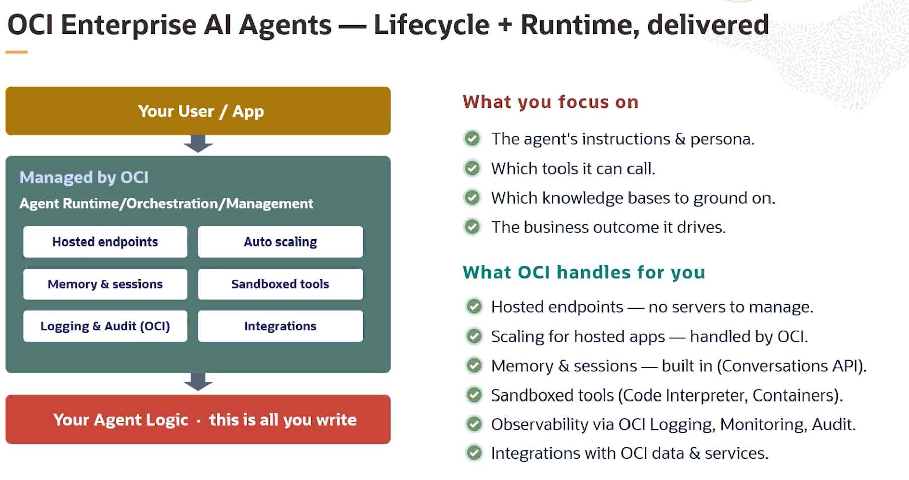

[🏠 Home](../README.md) › [Module 5: Agentic AI for OCI Enterprise AI](README.md) › 5.1

# 5.1 Module Introduction

## OCI Enterprise AI Agents Service: Managed Runtime

The OCI Enterprise AI Agents Service functions as a hosted, managed runtime for agent development and orchestration. It simplifies application architecture by fully managing infrastructure and lifecycle concerns.

## Two Approaches to Building Agents

## 1. OCI Responses API (API-First Approach)

- **Purpose:** The primary method for building agents quickly without infrastructure management. OCI natively handles the entire orchestration loop.

- **Compatibility:** Fully OpenAI compatible, conforming to the open responses specification. Developers can use existing knowledge of the OpenAI agents SDK.

- **OCI Distinction:** To adapt existing code, developers only need to update the base URL to OCI, configure OCI authentication, and route requests through OCI enterprise AI models in OCI regions.

## 2. Hosted Agentic Apps (Deployment Approach)

- **Purpose:** Designed for deploying custom agents as production services on fully managed infrastructure.

- **Workflow:** 1. Package the agent logic (using any framework) as a container image.

2\. Upload the image to the OCI registry.

3\. Deploy it as a managed hosted application.

- **OCI Distinction:** OCI automatically provisions the HTTP endpoint and manages auto-scaling, networking, storage, and authentication behind the scenes.

## Division of Labor

## Developer Responsibilities (Agent Logic)

You write the code that dictates what the agent does. You are responsible for defining:

- Agent instructions

- Tools the agent will use

- Knowledge sources

- Target business outcomes

## OCI Responsibilities (Managed Runtime)

OCI completely takes over six specific runtime concerns so developers do not have to build them:

1. **Hosted Endpoints:** Secures and provisions HTTPS endpoints for client invocation, paired with Identity Domain integration for authentication.

2. **Auto-Scaling:** Shields developers from capacity management. The Responses API scales transparently out of the box, while the Hosted Apps method scales deployed container infrastructure dynamically based on request load.

3. **State and Sessions:** Delivers built-in memory management (short-term, long-term, and context compaction). It utilizes a **Conversations API** to track session-based memory, allowing the agent to remember back-and-forth dialogue natively.

4. **Sandbox Tools:** Supplies isolated environments for execution.

    - *Code Interpreter Tool:* Allows models to safely write and execute Python code for complex problem-solving (e.g., data analysis).

    - *Containers API:* Executes custom containers for specialized processing tasks.

5. **Observability:** Provides foundational building blocks and integration for logging, monitoring, and auditing agent runs.

6. **OCI Data and Service Integration:** Exposes APIs to connect with OCI ecosystem features, including files, vector stores, function calling, Model Context Protocol (MCP), and Natural Language to SQL (NL to SQL) for querying enterprise data within Oracle Autonomous Databases.

Are you planning to build your upcoming agent using the Responses API, or will you be packaging a custom framework for the Hosted Agentic App deployment?

---

### 🔗 Related

- **Orchestration Layer** → [1.2 Agentic AI Core Components](../01-introduction-to-ai-agents/02-agentic-ai-core-components.md)
- **Memory** → [2.3 Demo: LangChain Building Blocks](../02-langchain-for-ai-agents/03-demo-langchain-building-blocks.md)
- **Model Context Protocol (MCP)** → [3.2 What Is MCP?](../03-model-context-protocol/02-what-is-mcp.md)
- **Responses API** → [4.2 OpenAI Responses API](../04-openai-responses-api-agents-sdk/02-openai-responses-api.md)
- **OCI Enterprise AI** → [5.3 Introduction to OCI Enterprise AI Platform](03-introduction-to-oci-enterprise-ai-platform.md)
- 📖 [Glossary](../glossary.md)

---

⬅️ [4.10 Summary](../04-openai-responses-api-agents-sdk/10-summary.md) | [⬆️ Module 5](README.md) | [5.2 Need for Agent Lifecycle and Runtime](02-need-for-agent-lifecycle-and-runtime.md) ➡️
