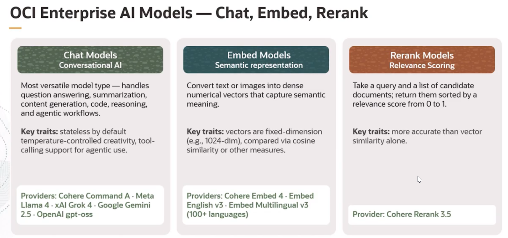
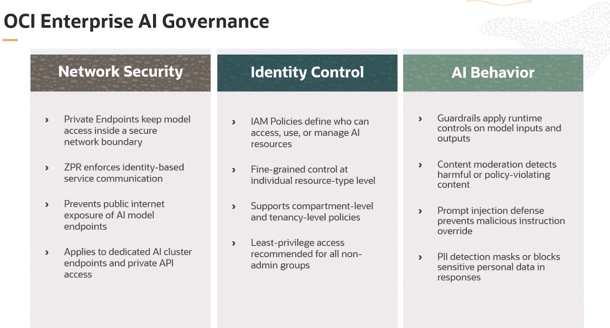

[🏠 Home](../README.md) › [Module 5: Agentic AI for OCI Enterprise AI](README.md) › 5.3

# 5.3 Introduction to OCI Enterprise AI Platform

## OCI Enterprise AI Platform Overview

The OCI Enterprise AI platform allows developers to build, deploy, and govern scalable AI applications. It is organized into three distinct layers:

- **OCI Enterprise AI Models (The Brain Layer):** Provides access to frontier models (OpenAI, Google, Meta, Cohere, etc.) through a consistent API.

- **OCI Enterprise AI Agents Service (The Action Layer):** Builds and orchestrates agentic workloads using managed tools, standard protocols (like MCP), and open-source frameworks.

- **OCI Enterprise AI Governance (The Trust Layer):** Enforces enterprise-grade security, compliance, and access controls using a defense-in-depth approach.

## The Brain Layer: Enterprise AI Models

## Core Model Types

- **Chat Models:** General-purpose models that take prompts and generate natural language. They are stateless by default but can use the OCI Conversations API for multi-turn memory. They support tool calling and rely on the temperature parameter to balance deterministic facts (lower values) with creative variance (higher values).

- **Embed Models:** Convert text (and sometimes images, like Cohere Embed 4) into fixed-dimension numerical vectors. They preserve geometric meaning so similar concepts sit closer together in vector space, enabling semantic search.

- **Rerank Models:** Specialized models used in Retrieval Augmented Generation (RAG) architectures. They take a large pool of documents retrieved via semantic search and score them for precise relevance before passing the top results to a chat model.

## The RAG Quality Chain

- **Embed Quality:** Determines **Recall** (how well the retrieved documents match the query).

- **Rerank Quality:** Determines **Precision** (how accurate and relevant the filtered documents are).

- **Chat Model Quality:** Determines **Generation** (the quality of the final natural language response).

## Serving Modes

Choosing a serving mode dictates cost, latency, data isolation, and custom model support.

| **Feature**          | **On-Demand**                                      | **Dedicated AI Clusters (DAC)**                                      |
|----------------------|----------------------------------------------------|----------------------------------------------------------------------|
| **Primary Use Case** | Exploration, prototyping, validation.              | Production-grade reliability, SLAs, compliance.                      |
| **Cost Structure**   | Pay per inference call (zero upfront commitment).  | Billed for active cluster hours, regardless of call volume.          |
| **Infrastructure**   | Shared GPUs.                                       | Physically dedicated GPUs (isolated to your tenancy).                |
| **Performance**      | Subject to dynamic throttling/rate limiting.       | Predictable latency for SLA commitments.                             |
| **Model Lifecycle**  | Access ends immediately if Oracle retires a model. | Existing clusters continue running uninterrupted if a model retires. |
| **Custom Models**    | Not supported.                                     | Supports fine-tuned and imported base models.                        |

## The Trust Layer: Enterprise AI Governance

Governance operates on a defense-in-depth model across three specific security layers:

- **Network Security:** Keeps unauthorized traffic out. Utilizes Private Endpoints for secure network boundaries and Zero Trust Packet Routing for identity-based service communication.

- **Identity Control:** Ensures only correct identities gain access. Managed via OCI Identity and Access Management (IAM) to enforce fine-grained access policies at the resource, compartment, or tenancy level.

- **AI Behavior (Guardrails):** Ensures safe model behavior at runtime. Applies content moderation directly to inputs and outputs, blocking prompt injections and detecting Personally Identifiable Information (PII).

Are you planning to prototype your initial application using the On-Demand serving mode, or do you already have a production use case requiring the isolation of Dedicated AI Clusters?

---

### 🔗 Related

- **RAG** → [6.3 Oracle AI Vector Search Workflow](../06-oracle-ai-database-agentic-ai/03-oracle-ai-vector-search-workflow.md)
- 📖 [Glossary](../glossary.md)

---

⬅️ [5.2 Need for Agent Lifecycle and Runtime](02-need-for-agent-lifecycle-and-runtime.md) | [⬆️ Module 5](README.md) | [5.4 Agentic AI for Enterprises](04-agentic-ai-for-enterprises.md) ➡️
