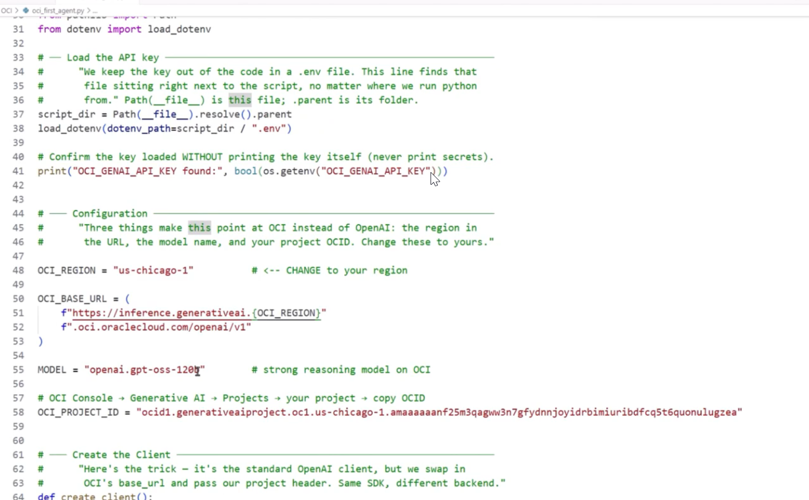
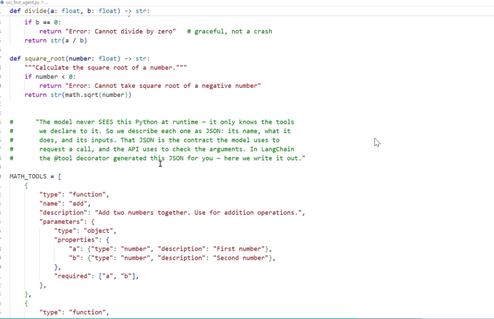
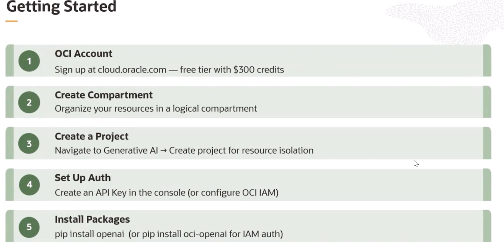
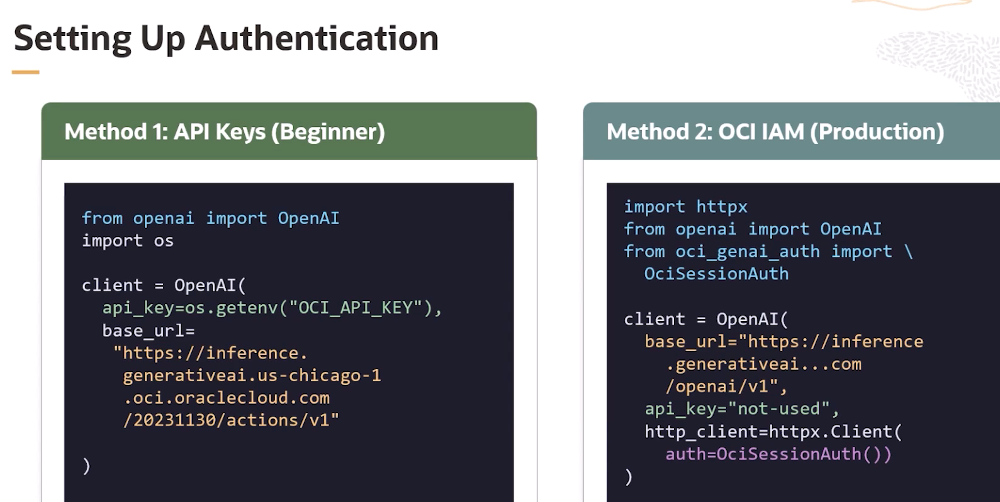
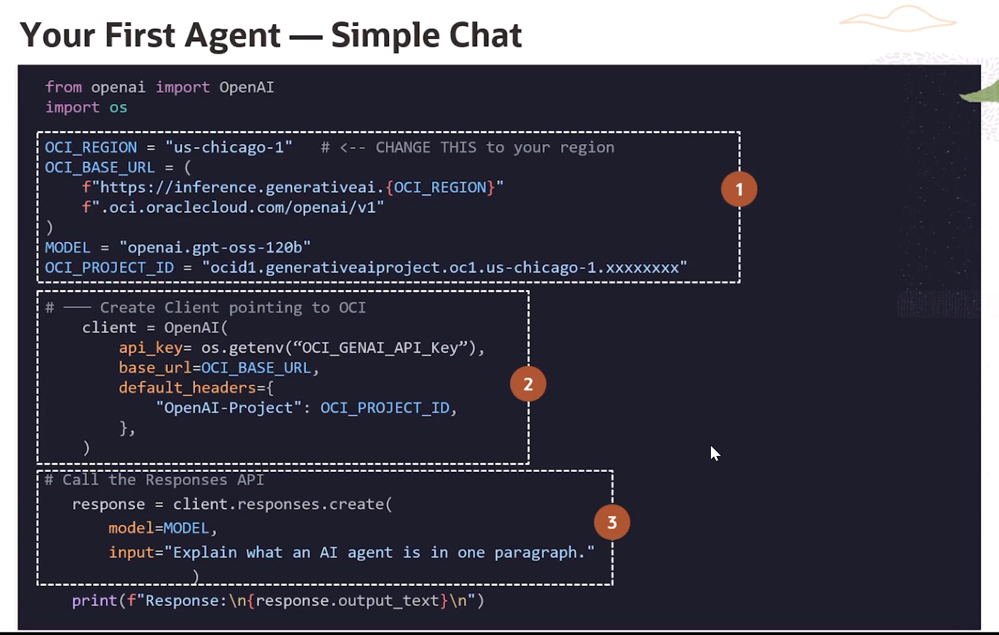
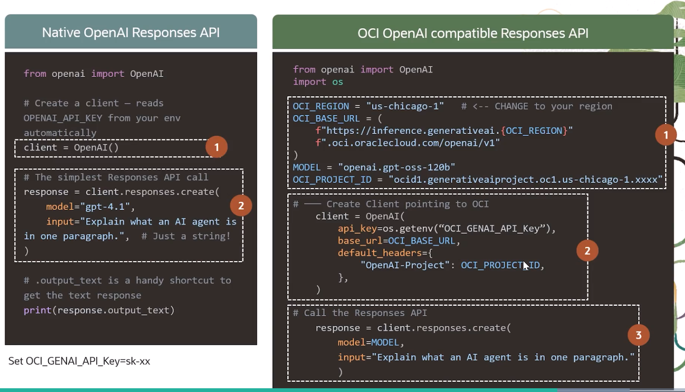

[🏠 Home](../README.md) › [Module 5: Agentic AI for OCI Enterprise AI](README.md) › 5.6

# 5.6 Demo: OCI Enterprise AI Agents Setup

## Prerequisites & OCI Console Setup

To deploy an AI agent using the OCI Enterprise AI Agents service, four console-level prerequisites and one local environment setup step must be completed before writing application logic.

## 1. Account & Compartment

- An active **Oracle Cloud Infrastructure (OCI) Account** is required.

- Workloads must be isolated within an active **Compartment** (an organizational container for cloud resources).

**2. Project Creation (**`FirstAgentProject`**)**

- **Purpose:** A Project acts as the root container that groups and organizes all assets associated with the agent (models, memory configurations, knowledge bases).

- **Console Action:** Navigate to the OCI Agents dashboard → Select the target Compartment → Click **Create Project**.

- **Configuration:** Provide a name (`FirstAgentProject`), add a description, and leave optional settings (like short-term memory compaction) disabled for baseline foundational deployments.

- **Output:** Once active, copy and save the **Project OCID** (Oracle Cloud Identifier), as it must be passed in the code headers.

**3. API Key Generation (**FirstAgentAPIKey**)**

- **Purpose:** Authenticates local or server-side application code against the OCI Generative AI backend.

- **Console Action:** Navigate to **API Keys** within the console → Click **Create API Key**.

- **Configuration:** Assign a descriptive name (FirstAgentAPIKey). The dashboard outputs two secret key strings (Key1 and Key2) along with an expiration date.

- **Security Rule:** You must copy and securely store the secret keys immediately upon generation. They are shown **only once** and cannot be retrieved later. Save them into a local `.env` file (e.g., as `GENAI_API_KEY`).

## 4. IAM Policy Configuration

- **Requirement:** Unless the executing user has full account administrator privileges, an explicit **Identity and Access Management (IAM) policy** must be attached to the user group or compartment.

- **Function:** Grants explicit runtime permissions for the application code to invoke models and read project assets within that compartment.





## Regional Model Routing & Selection

Model availability in OCI is region-locked. The target region in your code must match the infrastructure hosting your selected model.

| **Configuration Parameter** | **Demo Value**            | **Rationale**                                                                                                                                             |
|-----------------------------|---------------------------|-----------------------------------------------------------------------------------------------------------------------------------------------------------|
| **Region**                  | us-chicago-1 (US Midwest) | Selected because OpenAI open-weight models are hosted and available for inference in the Chicago data center.                                             |
| **Model ID**                | `openai.gpt-oss-120b`       | An open-weight LLM (~117 billion parameters) hosted natively on OCI. Available for both **On-Demand** and **Dedicated AI Clusters (DAC)** in this region. |
| **Documentation Reference** | OCI Model Region Matrix   | The OCI documentation site maintains a live matrix mapping model providers (Cohere, Gemini, Llama, OpenAI) to specific cloud regions.                     |

## Code Implementation: OCI vs. OpenAI SDK

The OCI Responses API is fully **OpenAI-compatible**. You use the standard openai Python SDK client, but redirect execution from OpenAI's servers to OCI's infrastructure by modifying three client parameters:

```python
# Conceptual implementation of the OCI client configuration
from openai import OpenAI
import os

client = OpenAI(
    api_key=os.getenv("GENAI_API_KEY"),  # 1. OCI API Key from Console
    base_url="https://inference.generativeai.us-chicago-1.oci.oraclecloud.com",  # 2. Regional OCI endpoint
    default_headers={
        "opc-project-id": "ocid1.project.oc1..."  # 3. OCI Project OCID
    },
)
```

**The Three OCI-Specific Routing Parameters**

`base_url`: Points the SDK to the regional OCI Generative AI inference endpoint (us-chicago-1) instead of `api.openai.com`.

`api_key`: Passes the OCI-generated API secret key rather than an OpenAI platform token.

`opc-project-id` **(Header)**: Injects the specific Project OCID into the request header so OCI can track asset usage, billing, and governance rules.

## Tool Definitions & The Manual Agent Loop

When working directly with the base Responses API without abstraction frameworks (such as LangChain or the OpenAI Agents SDK), tool definitions and orchestration loops must be constructed manually.

## 1. Manual JSON Tool Schemas

- The LLM cannot interpret raw Python code at runtime; it only understands structured JSON schemas describing what functions exist and what arguments they accept.

- While high-level frameworks use decorators (like `@tool` in LangChain) to auto-generate JSON schemas from Python docstrings, working directly with the Responses API requires developers to write and pass these JSON tool descriptions explicitly in the API payload.

## 2. The Anatomy of the Manual Agent Loop

High-level frameworks hide the recursive execution loop behind one-line commands like `agent.invoke()` or `runner.run_sync()`. When calling the API directly, you must write a manual while loop (~35 lines of code) to handle agentic reasoning:

```text
[User Prompt]
     │
     ▼
[Send Request to OCI Responses API] ◄─────────────────────────┐
     │                                                         │
     ▼                                                         │
[Model evaluates: Are tools needed?]                           │
     │                                                         │
     ├──► YES ──► [Model outputs Tool Name & JSON Args]        │
     │                      │                                  │
     │                      ▼                                  │
     │            [Local Python executes Tool Function]        │
     │                      │                                  │
     │                      ▼                                  │
     │            [Append execution result to History] ────────┘
     │
     └──► NO ───► [Model generates Final Text Response] ──► [Return to User]
```

## Demo Verification & Execution

Running the finalized Python script tests two distinct interaction patterns against the OCI backend:

1. **Simple Chat (Text-In / Text-Out):**

    - **Input:** *"What is an AI agent?"*

    - **Execution:** The request routes to us-chicago-1, authenticates via the project header, processes through `openai.gpt-oss-120b` on Oracle GPUs, and returns a standard natural language definition.

2. **Autonomous Tool Calling:**

    - **Input:** A math-based prompt requiring calculation.

    - **Execution:** The LLM intercepts the prompt, identifies the matching math tool from the JSON schema, pauses generation to request local script execution, ingests the returned mathematical calculation, and outputs the final synthesized answer.

## Demo Screenshots









---

### 🔗 Related

- **AI Agent** → [1.1 What Is an AI Agent?](../01-introduction-to-ai-agents/01-what-is-an-ai-agent.md)
- **LangChain** → [2.2 Introduction to LangChain](../02-langchain-for-ai-agents/02-introduction-to-langchain.md)
- **Memory** → [2.3 Demo: LangChain Building Blocks](../02-langchain-for-ai-agents/03-demo-langchain-building-blocks.md)
- **Responses API** → [4.2 OpenAI Responses API](../04-openai-responses-api-agents-sdk/02-openai-responses-api.md)
- **OCI Enterprise AI** → [5.3 Introduction to OCI Enterprise AI Platform](03-introduction-to-oci-enterprise-ai-platform.md)
- **OCI Responses API** → [5.5 OCI Enterprise AI Agents Building Blocks](05-oci-enterprise-ai-agents-building-blocks.md)
- 📖 [Glossary](../glossary.md)

---

⬅️ [5.5 OCI Enterprise AI Agents Building Blocks](05-oci-enterprise-ai-agents-building-blocks.md) | [⬆️ Module 5](README.md) | [5.7 OCI Enterprise AI Agents: Deploy & Scale](07-oci-enterprise-ai-agents-deploy-and-scale.md) ➡️
