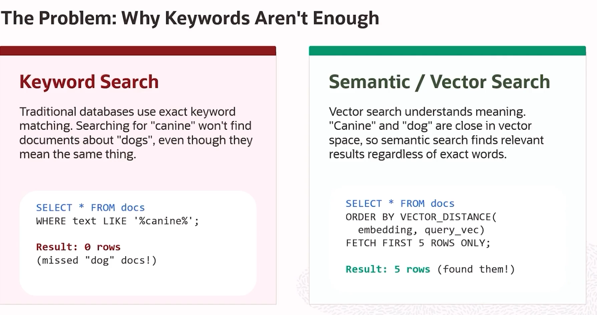

[🏠 Home](../README.md) › [Module 6: Agentic AI for Oracle AI Database](README.md) › 6.2

# 6.2 Introduction to Oracle AI Vector Search

## Embeddings, Vectors, and Oracle AI Vector Search

## 1. The Core Problem vs. The Vector Solution

- **Traditional Database Search:** Relies on exact keyword matching. For example, a query for "canine" will fail to return a document containing only the word "dog," causing user friction.

- **Semantic Search:** Resolves keyword limitations by focusing on contextual meaning. It converts data into mathematical representations so that semantically related concepts cluster near one another in a geometric vector space.

- **Oracle AI Vector Search:** Integrates native semantic search functionality directly into the relational engine, allowing developers to execute vector similarity matches alongside standard relational predicates within a single query.



## 2. Core Concepts: Vectors and Embedding Models

- **Vector Definition:** A high-dimensional list of numbers acting like mathematical coordinates. Unlike a 2D GPS point, vector representations scale to hundreds or thousands of dimensions to capture deep semantic attributes.

- **Vector Space Mapping:** Similar items are plotted close together; disparate items are placed far apart.

  - **Cluster A (Animals):** *dog*, *puppy*, *canine* group together.

  - **Cluster B (Animals):** *cat*, *kitten*, *feline* group together.

  - **Outlier:** *car* plots far away because a vehicle is semantically distinct from animals.

- **Embedding Model Examples:**

  - **Hugging Face (**all-MiniLM**):** Outputs **384 dimensions**. Highly recommended for beginners and lightweight implementations.

  - **OpenAI (**text-embedding-large**):** Outputs **3,072 dimensions**. Frequently leveraged for high-accuracy production workloads.

- **In-Database Execution:** Oracle supports running **ONNX (Open Neural Network Exchange)** embedding models directly inside the database engine. This allows user data to be converted into vector embeddings natively without pulling data out to external APIs.

## 3. The Embedding Generation Pipeline

```text
[ Input Data ] ➔ [ Tokenizer ] ➔ [ Transformer Neural Network ] ➔ [ Dense Vector Output ]
```

**Input Data ingestion:** Raw text, images, or audio assets enter the ingest pipeline.

1. **Tokenization:** A specialized tokenizer splits raw strings into subword pieces called tokens.

    - *Example (BERT Tokenizer):* The string "Embedding use case for chunking" contains 4 distinct words but is parsed into 8 tokens.

    - *Syntax Indicator:* In BERT, a double hash (##) prefixes a token to denote that it is a continuation of a subword piece rather than a standalone word.

2. **Neural Network Processing:** A transformer-based neural network evaluates the tokenized sequence and outputs a single dense vector capturing the overall semantic context.

3. **Architectural Bottleneck:** Tokenizers are bound by strict input window limitations (typically **512 tokens** or slightly higher). For extensive enterprise documents, a robust document **chunking** strategy must be applied prior to tokenization.

## 4. Oracle AI Vector Search Architecture

- **Architectural Paradigm:** Oracle AI Vector Search is a built-in core feature of the Oracle Database, not a standalone product extension.

- **Unified Storage:** Eliminates the operational overhead of provisioning, securing, and maintaining isolated vector databases (e.g., Pinecone). Vector fields reside directly inside standard relational tables adjacent to business data (e.g., customer profiles, transactional orders).

- **Enterprise Stability:** Vector transactions inherit Oracle's complete enterprise-grade availability stack, including strict ACID transaction compliance, transparent backups, active security controls, and proven engine scalability.

- **The** `VECTOR_DISTANCE` **Function:** A native SQL function utilized to calculate the distance between target vectors to identify top-K similar items.

- **Relational Predicate Concurrency:** The true architectural advantage of the engine is the ability to fuse high-dimensional similarity queries with structured relational filtering (WHERE clauses) in a single unified execution plan.

## Hybrid SQL Query Model

- Traditional vector databases struggle to execute low-latency geometric searches combined with deep relational filters. Oracle handles this natively inside its relational engine:

```sql
SELECT house_id, address, price
FROM real_estate_listings
WHERE price < 500000
  AND city = 'New York'
ORDER BY VECTOR_DISTANCE(image_embedding, :input_house_photo_vector)
FETCH FIRST 5 ROWS ONLY;
```

---

### 🔗 Related

- **Embeddings** → [6.3 Oracle AI Vector Search Workflow](03-oracle-ai-vector-search-workflow.md)
- 📖 [Glossary](../glossary.md)

---

⬅️ [6.1 Agentic AI for Oracle AI Database](01-agentic-ai-for-oracle-ai-database.md) | [⬆️ Module 6](README.md) | [6.3 Oracle AI Vector Search Workflow](03-oracle-ai-vector-search-workflow.md) ➡️
