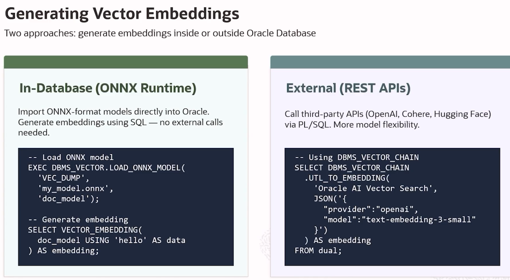
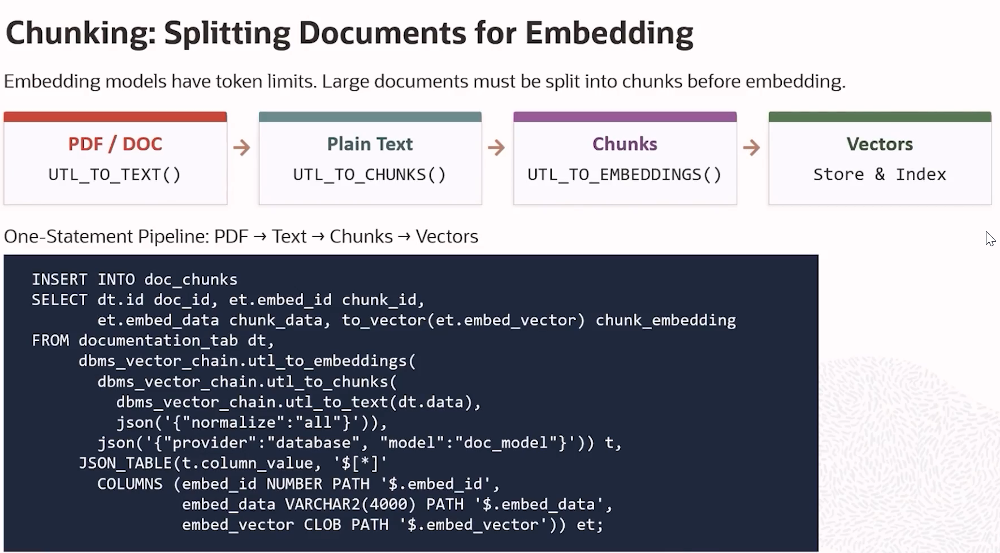

[🏠 Home](../README.md) › [Module 6: Agentic AI for Oracle AI Database](README.md) › 6.3

# 6.3 Oracle AI Vector Search Workflow

## 1. The 5-Step Oracle AI Vector Search Workflow

1. **Generate Embeddings:** Convert raw text, images, or documents into vector representations either natively inside the database or externally via REST APIs.

2. **Store Vectors:** Save vectors directly in Oracle relational tables alongside standard business data using the native VECTOR data type.

3. **Create Vector Indexes:** Build specialized indexes (**HNSW**, **IVF**, or **Hybrid**) to enable high-speed similarity search without performing full table scans over millions of records.

4. **Run Similarity Queries:** Execute SQL queries using the `VECTOR_DISTANCE` function combined with standard relational WHERE clauses for filtering.

5. **Feed RAG Pipelines:** Pass the retrieved, semantically relevant text chunks directly to a Large Language Model (LLM) for Retrieval-Augmented Generation (RAG).

## 2. Embedding Generation Strategies

| **Strategy**     | **Engine / Provider**   | **Key Characteristics**                                                                                                                              |
|------------------|-------------------------|------------------------------------------------------------------------------------------------------------------------------------------------------|
| **In-Database**  | Native **ONNX Runtime** | Imports ONNX-format models directly into Oracle. Uses the `VECTOR_EMBEDDING` SQL function. Zero network calls, zero data exfiltration, lowest latency. |
| **External API** | OpenAI, Cohere, etc.    | Calls third-party REST APIs using the `DBMS_VECTOR_CHAIN` PL/SQL package to access external foundation models.                                         |



## 3. Document Processing & Chainable Utility Functions

Oracle provides chainable SQL utility functions to handle large document ingestion (such as PDFs or Word files exceeding token limits like 512 tokens) directly within the database engine.

- `UTL_TO_TEXT`**:** Extracts plain text from binary file formats (PDFs, Word documents).

- `UTL_TO_CHUNKS`**:** Splits extracted text into smaller segments based on configurable strategies (by word, sentence, or paragraph). Allows custom parameters for **chunk size** and **chunk overlap** to preserve semantic context across boundaries.

- `UTL_TO_EMBEDDINGS`**:** Takes text chunks and converts them into vector embeddings.

- **Single SQL Pipeline:** All three functions can be chained together inside a single INSERT statement to extract, chunk, embed, and store document data in one execution step.



**4. The Native** VECTOR **Data Type**

The VECTOR data type is declared like any standard relational column and supports both flexible and strict schema definitions.

- **Flexible Syntax:** VECTOR — Accepts embeddings of any dimension count or storage format.

- **Strict Syntax:** VECTOR(768, INT8) — Enforces exactly 768 dimensions stored as 8-bit integers.

- **Storage Formats:**

  - FLOAT32 (Default 32-bit floating point)

  - FLOAT64 (64-bit double precision)

  - INT8 (8-bit integer for quantized models)

  - **Binary** (1-bit representations)

- **Dense vs. Sparse Storage:**

  - **Dense:** Stores values for every dimension explicitly.

  - **Sparse:** Stores only non-zero dimensions, optimizing storage for sparse embedding models.

- **Internal Engine Storage:** Stored internally as **SecureFile BLOBs**, typically occupying between **1.5 KB and 10 KB** per vector depending on dimensionality and format.

## 5. Vector Indexing Architectures

Without indexing, similarity search requires a full table scan, calculating distance against every vector—which degrades performance at millions of rows.

| **Index Type** | **Full Name**                         | **Underlying Mechanism**                                                                                                                       | **Best Use Case**                                                             |
|----------------|---------------------------------------|------------------------------------------------------------------------------------------------------------------------------------------------|-------------------------------------------------------------------------------|
| **HNSW**       | Hierarchical Navigational Small World | Builds an in-memory, multi-layered graph. Top layers have few connections for fast routing; lower layers have dense connections for precision. | Highest speed and low-latency queries across large datasets.                  |
| **IVF**        | Inverted File Flat                    | Uses k-means clustering to partition vector space into centroids. Queries only search the nearest cluster partitions.                          | Balanced query performance with lower memory footprint than HNSW.             |
| **Hybrid**     | Hybrid Vector Index                   | Combines semantic vector indices with traditional keyword/text search indices.                                                                 | Workloads requiring simultaneous semantic meaning and exact keyword matching. |

## 6. Similarity Search & Distance Metrics

Similarity search measures geometric distance between query vectors and stored database vectors using the `VECTOR_DISTANCE` function.

## Standard Distance Metrics

- **Cosine (**COSINE**):** Measures the angle between vectors. Default and most popular metric for text embeddings.

- **Euclidean (**EUCLIDEAN **/** L2**):** Measures straight-line distance. Optimal for spatial or geospatial coordinates.

- **Dot Product (**DOT**):** Evaluates both vector direction and magnitude.

- **Manhattan (**MANHATTAN **/** L1**):** Sums absolute axial differences. Highly robust against data outliers.

**Core Rule:** Always specify the exact distance metric that the underlying embedding model was trained on during similarity queries.

## SQL Query Execution Pattern

To retrieve the top-k most similar records, combine `VECTOR_DISTANCE` ordering with standard relational filtering:

```sql
SELECT chunk_text, VECTOR_DISTANCE(chunk_vector, :query_vector, COSINE) AS distance
FROM document_chunks
WHERE department = 'Finance'
ORDER BY distance
FETCH FIRST 5 ROWS ONLY;
```

---

### 🔗 Related

- **Memory** → [2.3 Demo: LangChain Building Blocks](../02-langchain-for-ai-agents/03-demo-langchain-building-blocks.md)
- **Oracle AI Vector Search** → [6.2 Introduction to Oracle AI Vector Search](02-introduction-to-oracle-ai-vector-search.md)
- 📖 [Glossary](../glossary.md)

---

⬅️ [6.2 Introduction to Oracle AI Vector Search](02-introduction-to-oracle-ai-vector-search.md) | [⬆️ Module 6](README.md) | [6.4 Demo: Oracle AI Vector Search](04-demo-oracle-ai-vector-search.md) ➡️
