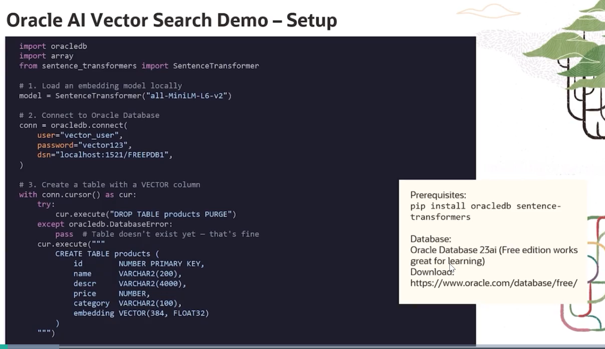
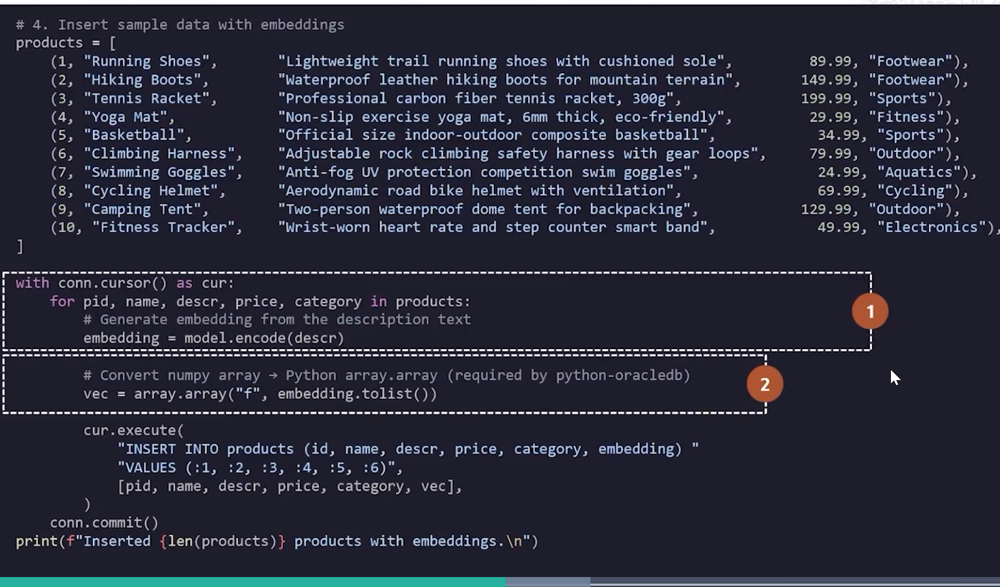
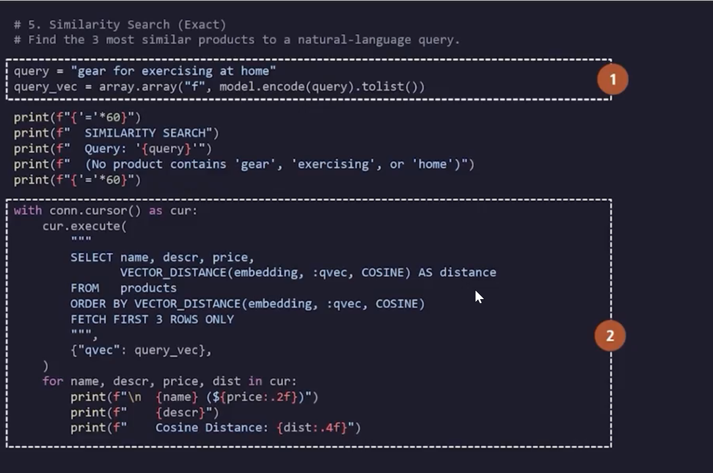

[🏠 Home](../README.md) › [Module 6: Agentic AI for Oracle AI Database](README.md) › 6.4

# 6.4 Demo: Oracle AI Vector Search

## Phase I: System Prerequisites & One-Time Database Setup







## 1. Prerequisites & Environment Initialization

- To interface Python with Oracle AI Vector Search, two core packages must be installed:

- oracledb**:** The official Python driver for Oracle Database.

- sentence-transformers**:** Specifically utilizing the all-MiniLM-L6-v2 embedding model.

  - *Model Profile:* Outputs **384-dimensional** dense vectors. It has a lightweight footprint (~80 MB) but yields strong semantic matching performance for basic applications.

## 2. Database Driver Operations

- The oracledb driver operates in two architectural modes:

- **Thin Mode (Default):** A pure Python implementation that connects directly to the database over the network via standard connection strings (`oracledb.connect`). It requires zero native Oracle client libraries, configuration files, or local environment variables.

- **Thick Mode:** Utilizes external native Oracle Client libraries for advanced features (not required for this baseline implementation).

## 3. Native Table DDL Design

- Oracle AI Vector Search allows vector columns to be treated as standard database attributes. They are stored natively in the same relational schema adjacent to standard transactional fields.

```sql
CREATE TABLE product_catalog (
    id                 NUMBER PRIMARY KEY,
    name               VARCHAR2(100),
    description        VARCHAR2(1000),
    price              NUMBER,
    category           VARCHAR2(50),
    description_vector VECTOR(384, FLOAT32) -- Enforces dimension count & storage format
);
```

**Schema Integrity Constraints:** The vector definition explicitly mandates a shape of 384 to map perfectly to the all-MiniLM model output.

- **Storage Optimization:** The FLOAT32 constraint specifies 32-bit floating-point precision per dimension for optimization.

## Phase II: Data Ingestion & Type Customization

- \[ Raw Text Description \] ➔ \[ all-MiniLM Encoding \] ➔ \[ NumPy Array \] ➔ \[ Python `array.array` Conversion \] ➔ \[ SQL INSERT \]

## 1. The Serialization Type Constraint

- When embedding raw strings via sentence-transformers, the model encodes the text into a **NumPy array**. However, passing a NumPy array directly into the database driver throws a severe execution TypeError.

- **Driver Interface Rule:** The oracledb driver requires vector columns to be explicitly passed as Python's built-in `array.array` structures (specifically configured with floating-point typing). The driver cannot natively serialize NumPy types to Oracle's binary internal vector representation.

## 2. Ingestion Logic Flow

- For each catalog row to be added:

Extract the string value from the description column (e.g., *"waterproof leather hiking boots for mountain terrain"*).

Pass the text to the transformer network to generate the mathematical representation.

Cast the resulting array explicitly to a compliant Python float list (`embedding.tolist()`).

Execute a standard SQL INSERT statement binding the ID, categorical properties, and the serialized float array into the target table row.

## Phase III: Advanced Similarity Search Execution

## Approach A: Pure Semantic Vector Search

- **Workflow:** The system takes a human query string (e.g., *"gear for exercising at home"*), maps it using the identical all-MiniLM model, and passes the vector to the database's `VECTOR_DISTANCE` function.

- **The Semantic Advantage:** A standard inverted-index keyword search against this query yields **zero rows**, as none of the target tokens (*gear*, *exercise*, *home*) exist verbatim in the dataset text. Vector search successfully maps the contextual proximity of tokens, surfacing *yoga mats* and *fitness trackers* as the top matching items based on shortest geometric distance.

## Approach B: Hybrid Vector + Relational Querying

- Standalone vector databases lack the ability to process complex relational predicates concurrently. They require applications to perform vector queries first, then apply application-side data filtering (or vice versa), impacting performance. Oracle resolves this by executing the entire hybrid operation inside a single SQL syntax block.

## Query Objective:

- Find items contextually matching *"protection for water sports"* that cost **under \$100**.

```sql
SELECT id, name, price,
       VECTOR_DISTANCE(description_vector, :query_vector, COSINE) AS distance
FROM product_catalog
WHERE price < 100 -- Relational predicate evaluated first
ORDER BY distance
FETCH FIRST 3 ROWS ONLY;
```

**Database Execution Optimization:**

1. **Relational Pruning:** The Oracle query engine applies the standard WHERE price \< 100 condition *before* similarity scoring begins. High-cost items matching the concept (e.g., \$149 hiking boots, \$199 tennis rackets) are immediately stripped out.

2. **Targeted Vector Scoring:** The `VECTOR_DISTANCE` calculation and subsequent sort array are restricted only to rows meeting the monetary predicate.

3. **Output Resolution:** The database outputs the precise matches (e.g., *swimming goggles* for \$25) sorted from shortest to longest distance in one optimized round trip.

---

### 🔗 Related

- **Oracle AI Vector Search** → [6.2 Introduction to Oracle AI Vector Search](02-introduction-to-oracle-ai-vector-search.md)
- **Embeddings** → [6.3 Oracle AI Vector Search Workflow](03-oracle-ai-vector-search-workflow.md)
- 📖 [Glossary](../glossary.md)

---

⬅️ [6.3 Oracle AI Vector Search Workflow](03-oracle-ai-vector-search-workflow.md) | [⬆️ Module 6](README.md) | [6.5 Oracle AI Database Private Agent Factory](05-oracle-ai-database-private-agent-factory.md) ➡️
